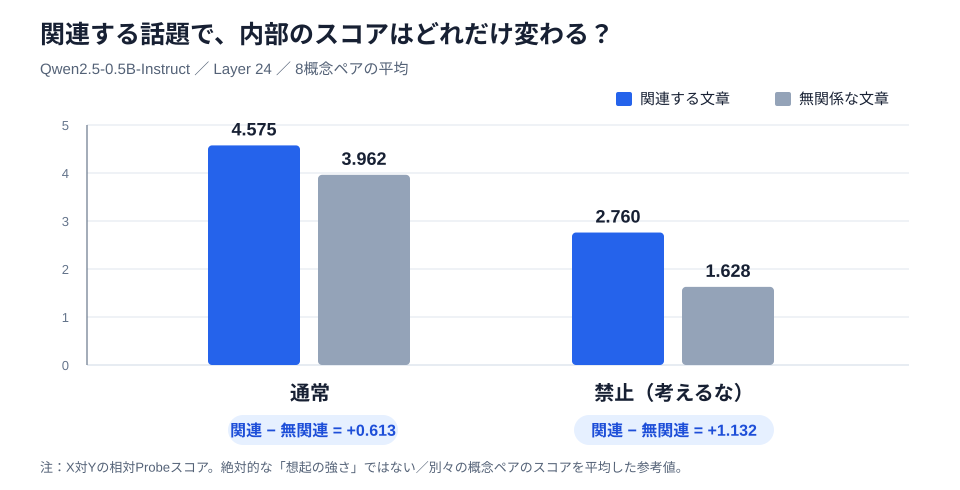

# 1ページでわかる卒論：これまでに何を確かめ、次に何を調べるか

> **テーマ案B（採用）**：**LLMにおける抑制概念の再活性化――意味的距離が内部表現に与える影響**  
> **大きな疑問（案Aは動機づけ）**：「AIに『バナナを考えるな』と言ったら、AIは本当にバナナを忘れるのか？」

## まず、何を調べたいの？

AIに「**バナナを考えるな**」と指示したあと、**「黄色い果物」「ゴリラ」「熱帯雨林」「電車」**など、バナナとの関係の強さが異なる話題を与える。

**知りたいこと：禁止した概念に対するAI内部の反応は、あとから与える話題との「意味的な近さ」によって、どう変わるのか？**

ここでいう「内部」とは、LLMが文章を処理するときに各層で作る数値（**Hidden State**）。それを **Concept Probe**（概念XかYかを区別する小さな分類器）で読み取る。Probeは「本当に考えている／忘れた」を直接測る機械ではなく、**XとYを区別する情報が読み取れるか**を調べる方法。

## 先行研究 → 自分の予備実験：何がわかった？

| | 先行研究の問い・示したこと | 自分が確認したこと（v3実測） |
|---|---|---|
| **① [Mannら：白熊効果](https://arxiv.org/abs/2511.12381)** | 「考えるな」という指示の効果は、その後に読む文章やモデルによって変わる。 | 関連する話題を与えると、**禁止語が65%**出現。無関連なら**2.5%**。また「代わりにYを考えろ」では関連話題でも**20%**まで下がった。 |
| **② [Zhouら：否定の内部処理](https://proceedings.mlr.press/v306/zhou26bq.html)** | LLMの否定処理には、対象を**抑える**働きと、代わりの意味を**作る**働きが関わる。 | 簡易3択では肯定文の正答率**100%**、否定文**18.5%**（単語候補の尤度で比較）。否定問題で回答が大きく崩れた。 |
| **③ 自分のConcept Probe実験** | 上の研究から発展させ、「出力」だけでなく内部表現も見る。 | 最終層のProbeは平均**ROC-AUC 0.972**。関連・無関連の内部スコア差は、**禁止条件のほうが大きかった**。 |

> **注意**：原論文を同条件で厳密に再現した「追試」ではなく、問題設定を参考にした小規模な**予備実験**。使用モデルは `Qwen/Qwen2.5-0.5B-Instruct`。また今回のMann型では、関連話題でも**通常95% ＞ 禁止65%**であり、「禁止すると通常より出力が増える」という厳密な白熊効果は確認していない。

## 実測グラフで見る、3つの発見

### ① 「考えるな」と言っても、関連する話題では禁止語が出てくる

**読むポイント**：関連話題1回では**禁止65%**、無関連話題1回では**2.5%**。禁止だけでは出力を完全には防げず、**置換指示はさらに出現率を下げた**（関連1回で20%）。この図は**回答文に単語が書かれた割合**であり、内部の概念を直接測ったものではない。

### ② LLMの内部から、どちらの概念か読み取れた

**読むポイント**：「バナナ」「リンゴ」のような名前を直接含まない説明文でも、**最終層ではXかYかを高い精度で区別できた**（平均AUC **0.972**、8概念ペアすべてでAUC 0.75以上）。ただし各ペアの検証例は6件と少ない。

### ③ 禁止の有無で、関連話題への「内部の反応の差」が違った

**読むポイント**：通常は関連話題と無関連話題の内部スコア差が**0.613**、禁止では**1.132**。つまり、**関連する文章と無関係な文章に対するスコアの開きが、禁止した場合のほうで大きかった**。8概念それぞれで「禁止条件特有の差の差（DID）」は正だった（[概念別グラフ](figures/04_probe_did.svg)）。

**ここを誤解しない**：禁止条件のスコアそのものは通常より**低い**。したがって「禁止すると概念が普通より強くなる」とは言えない。また、異なる文章間の比較なので、「いったん忘れたものが再活性化した瞬間」を直接見たわけでもない。

## では、卒論では何を新しく調べる？

今の予備実験は、手がかりを**「関連する／無関係」**の2つに分けただけ。

**次のResearch Question（案B）**：

> **禁止された概念と、その後に与える言葉の「意味的距離」は、LLM内部でその概念を区別するスコアの変化にどう影響するか？　それは通常の場合と違うか？**

**小さな次の実験**：8概念を使い、各概念に対して「とても近い／近い／遠い／無関係」の**4段階**の手がかりを用意する。通常指示と禁止指示でそれぞれHidden Stateを取り、距離とProbeスコアの関係をグラフにする。さらに候補数や文章の長さ、Xの直接表記などを統制し、距離の順序も別モデルや人手評価で確認する。

**何が嬉しい？** 単に「禁止語を出力した／しなかった」だけでなく、**AIが否定指示と連想情報を内部でどう扱うか**を理解する手がかりになる。将来、よりよい禁止指示や置換方法を考える基礎にもなる。

---

**先生への30秒説明**：「『考えるな』と指示しても、関連する話題では禁止語が出力されました。さらに内部表現を調べると、概念XとYを識別でき、関連・無関連の話題に対するスコアの差が、通常と禁止で異なりました。そこで次は、話題との意味的距離を段階的に変え、内部表現への影響を調べたいです。」

**データ・詳細**：[v3実験ノートブック](../1015/white_bear_and_zhou_pilot_v3.ipynb) ／ [v3のCSV・結果ZIP](../1015/results_v3/20261016T054754Z/) ／ [実験別の詳しい解説](README.md)（01〜06のMarkdown）。  
**補足**：Zhou型の実測グラフは[こちら](figures/02_zhou_accuracy.svg)。肯定と否定では課題の難しさが異なるため、「否定を理解できない」とは断定しない。
