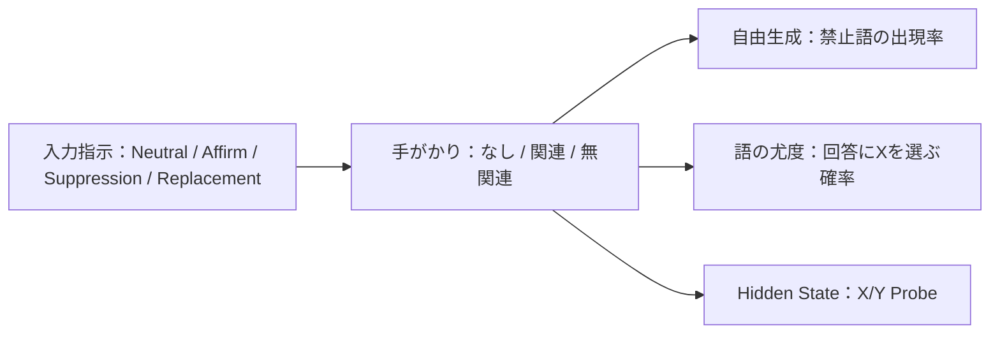

# 01｜実験全体像と設計

[← 目次](README.md) ｜ [次：Mann型](02_Mann型_抑制と置換.md)

## 研究背景：「出力しない」と「内部にない」は違う

「白熊を考えないで」と言われたとき、かえってその概念が意識に上ることがある。LLMに対する *Don't think of X* でも同様の振る舞いが起こるのか。また、出力にXが現れなくても、内部のHidden StateにはXの情報が残っているのか。

今回の実験は3つのレベルを区別する。

| 測定レベル | 具体例 | 測定の意味 |
|---|---|---|
| **生成された文章** | 禁止語 `banana` が実際に現れたか | 表面的な出力行動 |
| **候補単語の尤度** | 次の回答として `banana` がどの程度出やすいか | ある語形への確率的な支持 |
| **内部状態（Hidden State）** | X/Yを区別するProbeのスコア | 内部表現から読み出せる情報 |

**いずれも、知識がモデルの重みから削除されたことを意味しない**。この研究での「忘却」は、推論中に対象概念の情報が弱まるか、という操作的な意味で用いる。

## 先行研究との関係

| 参考研究 | 本実験で参考にした発想 | 行っていないこと |
|---|---|---|
| [Mann et al. (2025), *Don't Think of the White Bear*](https://arxiv.org/abs/2511.12381) | 禁止概念Xとその後の生成文、関連手がかりの関係 | 原論文と同一の刺激集合・モデルでの厳密な再現 |
| [Zhou et al. (2026), *How Language Models Process Negation*](https://proceedings.mlr.press/v306/zhou26bq.html) | 肯定/否定の処理差、層ごとの回答候補の観察 | 原論文のデータや抑制・構成回路への因果的介入 |
| 本研究独自の探索的Probe | XとYの線形識別を学習して、抑制・置換と関連刺激を比較 | 意味的距離を連続変数として検証する実験（**これから**） |

## 実験に使ったモデル

| 項目 | v3 |
|---|---|
| モデル | `Qwen/Qwen2.5-0.5B-Instruct` |
| Random seed | `42` |
| 環境 | Google Colab / CUDA |
| 対象概念 | banana, elephant, tiger, piano, coffee, ocean, castle, bicycle |
| 条件 | Neutral / Affirm / Suppression / Replacement |
| 妨害文・手がかり | なし、関連、無関連 |
| 主要な層 | Hidden-state indices **8 / 16 / 24**（0はEmbedding） |

### 4つの指示条件

対象をX=`banana`、置換先をY=`apple`とした例。実際には英語プロンプトを使った。

| 条件 | 具体的な指示 | 狙い |
|---|---|---|
| Neutral | `The topic word is banana.` | 禁止・置換のない比較対象 |
| Affirm | `Think of banana.` | 対象を明示的に考えさせる |
| Suppression | `Do not think of banana. Do not write the word banana.` | 対象の抑制 |
| Replacement | `Think of apple instead of banana. Do not write the word banana.` | ほかの概念へ置換 |

**注意**：Neutralも含め、指示文自体にはXが明記される。したがって、ProbeにXの痕跡があるだけでは「抑制しても残った」とは言えない。

## 実施した実験の関係

| 実験 | サンプル数・データ数 | 主な出力 |
|---|---|---|
| Mann型自由生成 | **800生成**：8概念×4指示×5試行×（0ブロック1条件＋1/3ブロック各2種） | `mann_generations_v3.csv` |
| 関連質問での対象語尤度 | **64条件**：8概念×4指示×2質問 | `cue_logprob_v3.csv` |
| Zhou型3択 | **108条件**：6語群×3回転×3正答位置×2極性 | `zhou_behavior_v3.csv` |
| 層別Logit Lens | **300行**：6語群×2極性×25地点 | `zhou_layer_lens_v3.csv` |
| Probeの性能評価 | **48行**：8概念×3層×2検証セット | `concept_probe_validation_v3.csv` |
| Probeの抑制条件測定 | **288行**：8概念×4条件×3手がかり×3層 | `concept_probe_measurements_v3.csv` |

## v2からv3へ改善したこと

| v2で判明した課題 | v3での対応 |
|---|---|
| `bananas` などの複数形を見落とした | 対象語の単数形と登録済み複数形をカウント |
| 妨害文0ブロックが関連/無関連の両方に存在し、同じ文章を別乱数で生成 | **0ブロックは共通の1条件のみ** |
| 指示条件間の生成乱数を揃えていなかった | 同一概念・同一手がかり・同一試行で乱数を対応づけ |
| 3択のA/B/Cに強いラベルバイアス | 回答「単語」尤度を追加し、ラベル補正も診断 |
| 内部の概念自体は測定できていなかった | 概念X対Yの線形Probeを導入、説明文で別途検証 |
| 単純集計のばらつきを把握しにくかった | 概念単位・語群単位の探索的Bootstrap区間 |

## 最初に理解しておきたい制約

- **8概念・6語群は小規模**。多くの試行や選択肢回転は独立した概念数を増やさない。
- 単語の出現頻度や単語尤度は、内部概念の強度と同一ではない。
- 線形Probeは相関的な読み出し器であり、内部の因果回路を示さない。
- 手がかりの「意味的距離」はまだ操作・定量化していない。次の卒論研究で行う。

**続き**：[02｜Mann型：抑制と置換](02_Mann型_抑制と置換.md)
