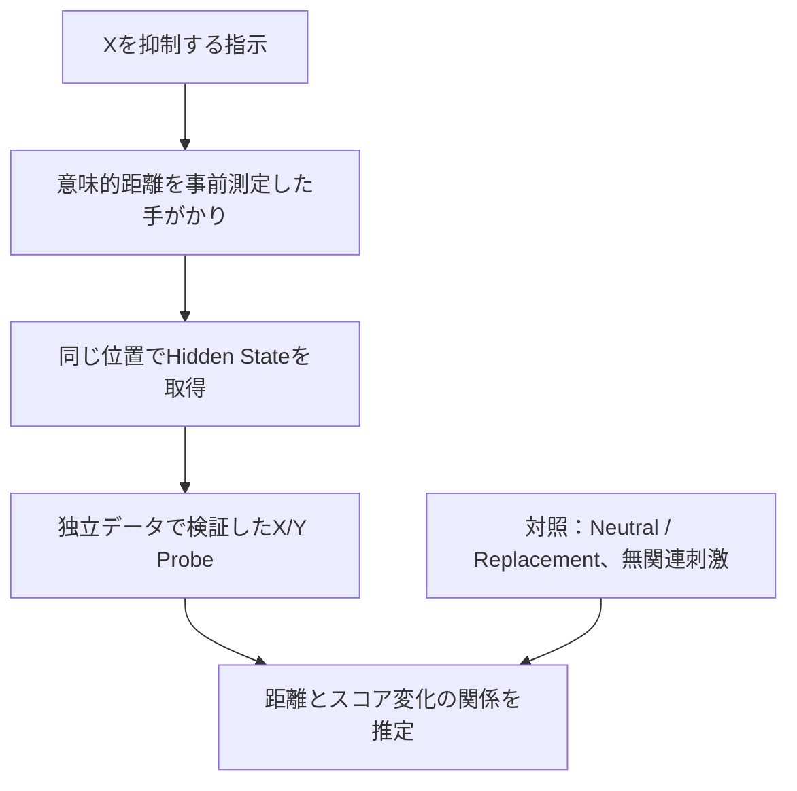

# 05｜研究展望：意味的距離と抑制概念の再活性化

[← 目次](README.md) ｜ [前：Concept Probe](04_ConceptProbe_内部表現.md) ｜ [次：再現手順](06_再現手順と解釈上の注意.md)

## 卒論テーマとして採用する方向

**背景・動機づけ（案A）**  
*Can Large Language Models Truly Forget a Suppressed Concept?*  
「LLMは抑制された概念を本当に忘れることができるのか？」

**具体的な研究テーマ（案B）**  
*Reactivation of Suppressed Concepts in Large Language Models: The Role of Semantic Distance*  
「LLMにおける抑制概念の再活性化：意味的距離が内部表現に与える影響」

**Research Question**  
*How does the semantic distance between an associative cue and a suppressed concept affect the representation of that concept in an LLM?*

日本語：**禁止された概念Xと、その後に与える手がかりとの意味的距離は、LLM内部のX/Y識別スコアの変化にどのような影響を与えるか？**

「再活性化」を主張するには、将来的には時間的な前後測定も必要。この段階ではまず**手がかりに対する応答差**を測定する。

## なぜこの研究につながるのか

| v3までに観測したこと | まだ残っている問い | 次の実験 |
|---|---|---|
| 関連1ブロックでSuppressionの禁止語出現65%、無関連1ブロックでは2.5% | 関連の「強さ」が徐々に効いているのか？ | 意味的距離を複数段階にする |
| 最終層Probeの説明文AUCは平均0.972 | 距離を変えても安定して測れるか？ | 独立したProbe検証セットを増やす |
| 最終層DIDが8/8概念で正 | 単なる語形・文脈長の効果でないか？ | 語形・トークン長・位置の統制 |
| Replacementの生成出現がSuppressionより少ない | 距離の効果は置換指示で変わるか？ | Neutral/Suppression/Replacementの比較 |

**新規性は現時点では候補**。「意味的距離を連続的に操作し、抑制条件の内部表現変化を測る」という切り口が先行研究とどこまで重なるか、文献調査が必要。

## 実験の直感的なイメージ

まずX=`banana`を禁止する。その後、Xを直接書かない刺激を与える。

| 説明用の候補刺激 | 直感的な関係 | 実験上の扱い |
|---|---|---|
| `a curved yellow fruit` | Xを直接記述 | 高関連の候補 |
| `a cartoon monkey` | 文化的な連想 | 中関連の候補 |
| `a tropical forest` | 間接的な場面連想 | 弱関連の候補 |
| `a railway ticket` | 関係が薄い | 無関連対照の候補 |

**重要**：この順序はあくまで説明例。人間の直感だけで「距離順」と決めない。別の埋め込みモデルの類似度、人手の関連度評定などで事前に順序を検証する。また「直接説明」と「文化的連想」は異なる関係の種類なので、距離だけで整理できるかも点検する。



## 仮説（未検証）

- **H1：距離依存性**：Xとの意味的距離が近い刺激ほど、X/Y ProbeのX寄りスコア変化が大きい。
- **H2：抑制条件特有の応答**：刺激に対するスコア変化は、NeutralとSuppressionで異なる。
- **H3：置換の修飾効果（追加実験）**：Suppressionと比べ、Replacementでは関連刺激によるX寄りの変化が弱まる可能性がある。

これは**仮説**であって、v3で確認済みの結果ではない。近い刺激でも、明示的に禁止した場合の内部表現がむしろ弱くなる可能性があるため、結果の方向は固定しない。

## 推奨する研究設計

### 第1段階：意味的距離に集中

| 設計項目 | 提案 |
|---|---|
| 対象概念 | まず既存8概念で動作確認、その後 **16〜24概念**程度へ拡張 |
| 手がかり | 各Xについて距離帯 **4水準**（近・中・遠・無関連）、各水準 **2〜3種類** |
| 距離指標 | 別の文埋め込みモデルで測定し、人手評定等で妥当性を確認 |
| 指示条件 | 初めは **Neutral / Suppression**、次にReplacementを追加 |
| 入力統制 | Xの直接表記を手がかりに含めない。文型、トークン長、回答位置を極力一致させる |
| 内部測定 | 事前検証済みProbeのX/Yスコアを複数層で比較 |
| 出力測定 | 別に語形尤度・自由生成での対象語出現率を測る |
| 統計 | 同一概念内の対応比較。概念を再標本化単位にした区間推定、距離と効果の相関/回帰 |

**注意**：文面を変えるとHidden Stateは決定論的に変わる。内部測定では同一プロンプトを乱数だけ変えて繰り返すより、**意味を保った独立した言い換え刺激を増やす**方が有効。

### 主評価指標の案

各概念X、各手がかりcについて、固定の無関連対照cue `u` を用意し、次の量を測る。

```text
D(X,c) = [Probe_Suppression(X,c) − Probe_Suppression(X,u)]
       − [Probe_Neutral(X,c)      − Probe_Neutral(X,u)]
```

その `D(X,c)` と事前計測した「Xとcueの意味的距離」の関係を調べる。単なる近/遠2群の比較にせず、**距離と効果の連続的関係**を示すのが中心。複数Probe間でスコア尺度が異なるので、各概念内の差・順位・標準化を優先し、異なるProbeの生スコアを単純合算した解釈は避ける。

### 第2段階：忘却（案A）の問いに近づける拡張

禁止指示から手がかりまでの無関連文脈の長さを固定して第1段階を終えてから、長さを0・短・長などへ変える。これにより、文脈距離との交互作用を探索できる。

しかし、**長い文脈 = モデルが時間経過によって自然に忘れる**ではない。トークン位置・文脈干渉の効果として扱う。

## ポスターで見せるべきストーリー

1. **Motivation**：「考えるな」と言われた概念は本当に消えるのか？
2. **Background**：Mann型・Zhou型を参考に、出力と否定処理を予備的に検証。
3. **Pilot Findings**：Mann型65% vs 20%、最終層Probe AUC 0.972、関連刺激DIDは8/8概念で正。
4. **Gap**：「関連する／しない」だけでは、意味的距離の影響は分からない。
5. **Main RQ**：意味的距離は抑制概念の内部表現にどう影響するか？
6. **Planned Experiment**：距離を4水準へ拡張し、厳密に統制して層別で検証。

**結論の言い方**：「関連する手がかりが抑制概念の内部表現に影響しうる、という予備的観察を得た。今後、意味的距離に沿った変化として一般化できるか調べる。」

**避けたい言い方**：「LLMは忘却できないことを証明した」「意味的距離と再活性化の法則を発見した」。どちらもまだ未検証。
