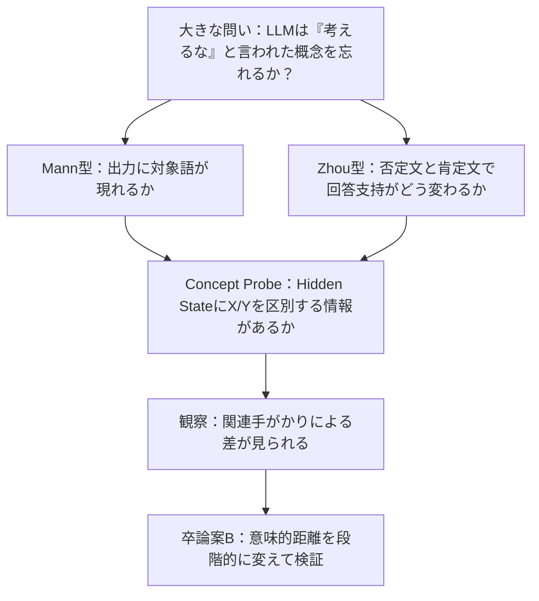

# 先行研究を参考にした予備実験の整理（2026-10-16）

> **このフォルダの目的**：卒業研究のテーマ選定・ポスター発表に向けて、これまでの **Mann型の思考抑制実験、Zhou型の否定処理実験、Concept Probe実験** の設計と実測結果をわかりやすく整理する。  
> **研究の方向性**：大きな動機づけは「LLMは抑制された概念を忘れられるか？」。具体的な卒論テーマは「**抑制概念の再活性化と意味的距離の関係**」。

## まず読むべき結論

| 何を調べたか | 実際に観測されたこと | **まだ言えないこと** |
|---|---|---|
| 思考抑制・置換（Mann型） | 関連刺激1ブロックの禁止語出現率：**Suppression 65.0% / Replacement 20.0%** | Neutralは95.0%なので、禁止によって通常より出現する「逆説的増加」は未確認 |
| 否定処理（Zhou型） | 単語候補の尤度による正答率：**肯定100.0% / 否定18.5%** | 課題の複雑さと回答バイアスを切り分けた純粋な否定能力の差ではない |
| 概念の内部表現（Probe） | 名前を含まない説明文への最終層Probe：**平均AUC 0.972、8/8概念でAUC≥0.75** | 概念が「忘却された／再活性化した」という因果・時間的過程の直接証明ではない |
| 関連刺激の内部効果（Probe） | 最終層で抑制条件特有の関連刺激効果（DID）が **8/8概念で正** | 意味的距離が連続的に効くかは未実験 |

## このフォルダの読み方

| 資料 | 内容 | 目安 |
|---|---|---|
| [01_実験全体像と設計.md](01_実験全体像と設計.md) | 研究背景、先行研究との位置づけ、実験条件、v2→v3の修正点 | まず全体を把握 |
| [02_Mann型_抑制と置換.md](02_Mann型_抑制と置換.md) | 禁止語の再出現、関連・無関連刺激、抑制と置換の差 | 行動実験の主結果 |
| [03_Zhou型_否定理解とLogitLens.md](03_Zhou型_否定理解とLogitLens.md) | 肯定・否定の正答率、選択肢バイアス、層別Logit Lens | 否定処理の確認 |
| [04_ConceptProbe_内部表現.md](04_ConceptProbe_内部表現.md) | Probeの検証、層別AUC、関連刺激の差の差（DID） | **卒論に最も直結** |
| [05_研究展望_意味的距離と再活性化.md](05_研究展望_意味的距離と再活性化.md) | 今後のRQ、実験計画、ポスターへのつなぎ方 | 次に着手 |
| [06_再現手順と解釈上の注意.md](06_再現手順と解釈上の注意.md) | 生データ・数値の追跡先、比較上の注意、検証項目 | 発表前に確認 |

## 研究の流れ

## データの出典と研究上の位置づけ

- **実測の主資料**：2026-10-16の[Colab v3結果フォルダ](../1015/results_v3/20261016T054754Z/)の `white_bear_zhou_pilot_v3_results.zip` 内にあるCSV・JSON。
- **実験コード**：[white_bear_and_zhou_pilot_v3.ipynb](../1015/white_bear_and_zhou_pilot_v3.ipynb)（Qwen/Qwen2.5-0.5B-Instruct）。
- **旧版**：v2の測定上の問題（複数形の数え漏れ、0ブロックでの重複比較、ラベル偏り等）を踏まえてv3を作成した。旧版・新版の数値は条件が変わっているため単純比較しない。
- **文献**：[Mann et al. (2025)](https://arxiv.org/abs/2511.12381)／[Zhou et al. (2026)](https://proceedings.mlr.press/v306/zhou26bq.html)。

**注意**：これらは「先行研究を参考にした小規模な予備実験」であり、原論文のモデル・データセット・介入操作を厳密に再現した追試ではない。図の数値は、断りがない限りすべてv3実測値。
