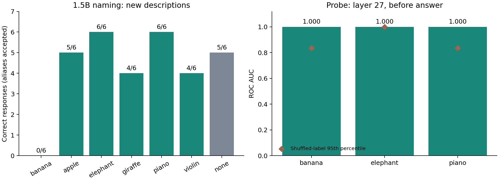

# 1.5B：新しい説明文と同義語を固定した確認

前回の校正集合で回答基準を満たさなかったため、典型的な特徴を複数含む新しい説明文で再確認する。問題文・採点・コードを推論前にmainへ保存した。

- 6概念×6説明＝36件、対象の説明がないnone対照6件。
- 質問は前回の文脈＋命名と同一、候補名は提示しない。
- モデルは固定revisionのQwen2.5-1.5B-Instruct、FP32、greedy。
- violin/fiddleを同じ概念として事前に採点。大文字・小文字、複数形にも対応し、広すぎるkeyboard等は認めない。
- Probeの学習用192入力と学習方法は前回のまま。今回の評価説明は学習へ加えない。

[PLAN.md](PLAN.md) / [問題文](items.json) / [採点規則](rules.json) / [Colabノートブック](fresh_description_check.ipynb)

この42文面は今回初めて生成モデルへ提示する。既存データとの完全一致と概念名・別名の直接漏洩を検査した。ただし、既存説明と同じ定義的特徴を含む言い換えであり、新しい概念や未知の意味領域への一般化の検証ではない。説明の明確さはAIによる設計・点検で、独立の人手評定はない。

採用基準は36件中30以上かつ各概念4/6以上。noneは5/6以上。Probeは27層・回答直前で全3ペアAUC>=.8かつ20シャッフル対照の95percentile超。少数例の運用基準であり、統計的確証ではない。

`python -m unittest discover -s 1103_fresh_check -p 'test_*.py' -v` で同義語・否定・曖昧回答・部分一致・問題データを検査できる。

保存結果は `python 1103_fresh_check/verify.py 1103_fresh_check/results` で再集計を検証し、`python 1103_fresh_check/analyze.py 1103_fresh_check/results` で図を再作成する。

## 実測結果

Colab T4で42入力を完了した。全原回答を確認し、同義語対応の採点、288個別Probeスコアからの24 AUC、合否、実行前固定ファイルのhashを再計算して一致を確認。生成上限による切り詰めは0件。

| 対象 | 正答 / 6 |
|---|---:|
| banana | 0/6 |
| apple | 5/6 |
| elephant | 6/6 |
| giraffe | 4/6 |
| piano | 6/6 |
| violin（fiddleも許容） | 4/6 |
| 対象なし対照（別枠） | 5/6 |

**説明文36件の合計は25/36（69.4%）。採用基準の30/36以上・各概念4/6以上を満たさず、今回の6概念構成での本実験採用は見送る。** none対照は基準を満たした。

前回の命名12/36（同義語Fiddleも事後に数えれば14/36）から値は上がっているが、評価文が変わっている。モデル自体の性能改善や、明確さの変更による因果効果を示す比較ではない。今回の36件にFiddleという回答はなく、同義語による追加正答は0件だった。

バナナ6件の原回答はMango、None、Watermelon、None、None、None。典型特徴を明示しても対応が不安定だった。キリンではGrizzly Bearとelephant、バイオリンではGuqinが各失敗例。none対照の1件はcowと回答した。モデル全般が概念を理解していないと断定するのではなく、この固定モデル・質問形式での課題性能が採用基準未達と解釈する。

### Probe：高AUCだけでは合格にならなかった

| ペア | 主Probe AUC | シャッフル20回の95percentile | 事前基準 |
|---|---:|---:|---|
| banana / apple | 1.000 | 0.836 | 達成 |
| elephant / giraffe | 1.000 | 1.000 | 未達 |
| piano / violin | 1.000 | 0.836 | 達成 |

ゾウのペアでは、シャッフル20回のうち2回もAUC 1.000に達したため、「対照の95percentileを超える」という事前基準を満たさなかった。したがって、全3ペアのProbe合格とも報告しない。20回・各ペア12説明の少数対照なので、これを概念情報が存在しない証拠や確証的な有意性判定とはみなさない。典型特徴を繰り返す評価集合で、ノイズを含む学習でも高い順位性能が出る可能性があり、より多様な説明での検証が必要。

## 今回の判断と次の設計

1.5B＋現在の命名課題は、6概念全体での採用を保留したままにする。バナナを事後に除外して全体を合格とする変更は行わない。

次にモデルを比較する場合は、今回固定した42問題・採点基準をそのまま使い、より大きいモデルで対応が安定するか確認する。繰り返し評価したこの集合は校正用となるため、採用後の最終確認は別の未使用集合で行う。Probeは説明の種類を増やし、少数の定義的特徴だけに依存しないかを確認する。

本実験の中心である意味的距離×指示条件の比較は、今回には含まれない。命名の基本性能の確認と、無関連手がかりから対象を無理に当てさせない本実験課題の設計を区別する。

## データ

`results/answers.csv` に全問題・質問・回答・正誤、`holdout_scores.csv` に個別Probeスコア、`probe_auc.csv` に全層・位置のAUC、`shuffled.csv` に対照、`training_design.csv` に固定学習入力、`manifest.json` にrevision・hash・合否を保存。`primary_probe_summary.csv` と図は保存データから再作成できる。
