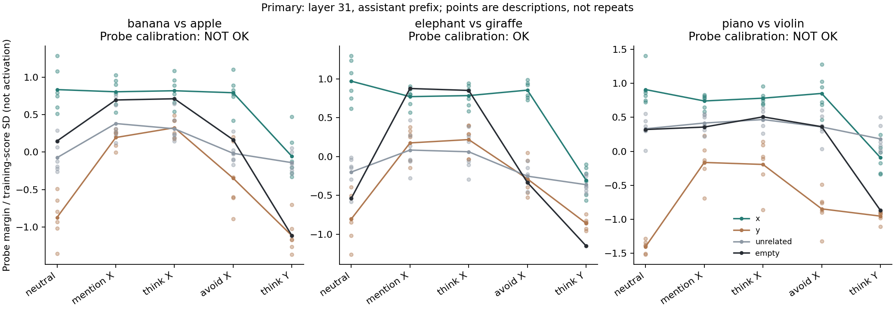

# Instruction sensitivity diagnostic

Exploratory. No answers were generated. Scores are relative X-vs-Y discriminability, not concept activation or suppression.

## Primary probe calibration

pair,primary_auc,shuffled_p95,shuffled_ge_true,shuffles,calibration_ok
banana,1.0,1.0,8,100,False
elephant,1.0,0.9180555555555555,1,100,True
piano,1.0,1.0,17,100,False

## Mean primary scores

pair,layer,position,cue_kind,condition,mean_z,n
banana,31,assistant_start,empty,avoid_x,0.1649295855638419,1
banana,31,assistant_start,empty,mention_x,0.6960155157423965,1
banana,31,assistant_start,empty,neutral,0.14825172258911148,1
banana,31,assistant_start,empty,think_x,0.7123335068027717,1
banana,31,assistant_start,empty,think_y,-1.1150551355638376,1
banana,31,assistant_start,unrelated,avoid_x,-0.01616439535971008,6
banana,31,assistant_start,unrelated,mention_x,0.38156058095319684,6
banana,31,assistant_start,unrelated,neutral,-0.0744871129767712,6
banana,31,assistant_start,unrelated,think_x,0.31201191976641446,6
banana,31,assistant_start,unrelated,think_y,-0.14066288557808668,6
banana,31,assistant_start,x,avoid_x,0.792826165872523,6
banana,31,assistant_start,x,mention_x,0.8055366737799412,6
banana,31,assistant_start,x,neutral,0.834579486833447,6
banana,31,assistant_start,x,think_x,0.819430217550285,6
banana,31,assistant_start,x,think_y,-0.056280610054789404,6
banana,31,assistant_start,y,avoid_x,-0.34827515337410325,6
banana,31,assistant_start,y,mention_x,0.19464220734940754,6
banana,31,assistant_start,y,neutral,-0.8718348371280386,6
banana,31,assistant_start,y,think_x,0.3254936992077869,6
banana,31,assistant_start,y,think_y,-1.1155322236113703,6
elephant,31,assistant_start,empty,avoid_x,-0.3355683198629714,1
elephant,31,assistant_start,empty,mention_x,0.8752412365770927,1
elephant,31,assistant_start,empty,neutral,-0.5385694302663394,1
elephant,31,assistant_start,empty,think_x,0.8504919539247467,1
elephant,31,assistant_start,empty,think_y,-1.1518818956077528,1
elephant,31,assistant_start,unrelated,avoid_x,-0.2535036421026653,6
elephant,31,assistant_start,unrelated,mention_x,0.08256869612740225,6
elephant,31,assistant_start,unrelated,neutral,-0.2005093907346859,6
elephant,31,assistant_start,unrelated,think_x,0.060637110153224545,6
elephant,31,assistant_start,unrelated,think_y,-0.36322148025704437,6
elephant,31,assistant_start,x,avoid_x,0.8542575350794549,6
elephant,31,assistant_start,x,mention_x,0.7704474824735575,6
elephant,31,assistant_start,x,neutral,0.9694781910074548,6
elephant,31,assistant_start,x,think_x,0.7838310873304195,6
elephant,31,assistant_start,x,think_y,-0.30664581740615926,6
elephant,31,assistant_start,y,avoid_x,-0.28882018887327515,6
elephant,31,assistant_start,y,mention_x,0.17471934164798938,6
elephant,31,assistant_start,y,neutral,-0.8052355894476827,6
elephant,31,assistant_start,y,think_x,0.2175050158084201,6
elephant,31,assistant_start,y,think_y,-0.8606676570764256,6
piano,31,assistant_start,empty,avoid_x,0.36264175709815727,1
piano,31,assistant_start,empty,mention_x,0.35722792321692043,1
piano,31,assistant_start,empty,neutral,0.32086636172284916,1
piano,31,assistant_start,empty,think_x,0.5074129127233947,1
piano,31,assistant_start,empty,think_y,-0.8695430917781194,1
piano,31,assistant_start,unrelated,avoid_x,0.35925925876955245,6
piano,31,assistant_start,unrelated,mention_x,0.41664545772308,6
piano,31,assistant_start,unrelated,neutral,0.3322805706258981,6
piano,31,assistant_start,unrelated,think_x,0.4676438206653484,6
piano,31,assistant_start,unrelated,think_y,0.1821780179738195,6
piano,31,assistant_start,x,avoid_x,0.852655582133238,6
piano,31,assistant_start,x,mention_x,0.7415567259465558,6
piano,31,assistant_start,x,neutral,0.9095400100853054,6
piano,31,assistant_start,x,think_x,0.7828267677514072,6
piano,31,assistant_start,x,think_y,-0.09246474099152481,6
piano,31,assistant_start,y,avoid_x,-0.8479942233512592,6
piano,31,assistant_start,y,mention_x,-0.16426350987622984,6
piano,31,assistant_start,y,neutral,-1.4049255964642153,6
piano,31,assistant_start,y,think_x,-0.1937213748352109,6
piano,31,assistant_start,y,think_y,-0.9552723796319262,6

If calibration is NOT OK, do not interpret instruction-score differences as concept changes. Empty is one fixed marker; no error bar or repeated-trial inference applies.

