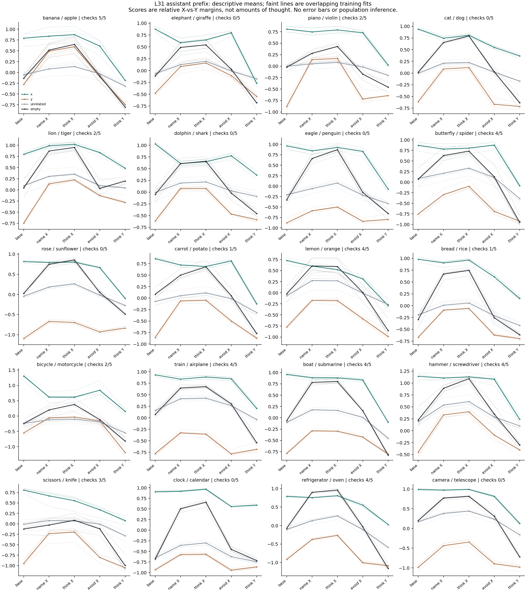

# 20-pair instruction-probe diagnostic

Exploratory. Five evaluation families per concept, four sentence wrappers each. Five overlapping training fits are not independent replications. Scores are relative discriminability, not thought or activation.

pair,fits_passed,min_auc,max_auc,all_fits_pass
banana,5,0.9600000000000001,1.0,True
bicycle,2,1.0,1.0,False
boat,4,1.0,1.0,False
bread,1,1.0,1.0,False
butterfly,4,1.0,1.0,False
camera,0,1.0,1.0,False
carrot,1,1.0,1.0,False
cat,0,1.0,1.0,False
clock,0,1.0,1.0,False
dolphin,0,1.0,1.0,False
eagle,0,1.0,1.0,False
elephant,0,1.0,1.0,False
hammer,4,1.0,1.0,False
lemon,4,1.0,1.0,False
lion,2,1.0,1.0,False
piano,2,1.0,1.0,False
refrigerator,4,1.0,1.0,False
rose,0,1.0,1.0,False
scissors,3,1.0,1.0,False
train,4,1.0,1.0,False

Only pairs passing all five primary checks are candidates for interpretation; failure is not evidence that concept information is absent. No model adoption or causal suppression claim.

