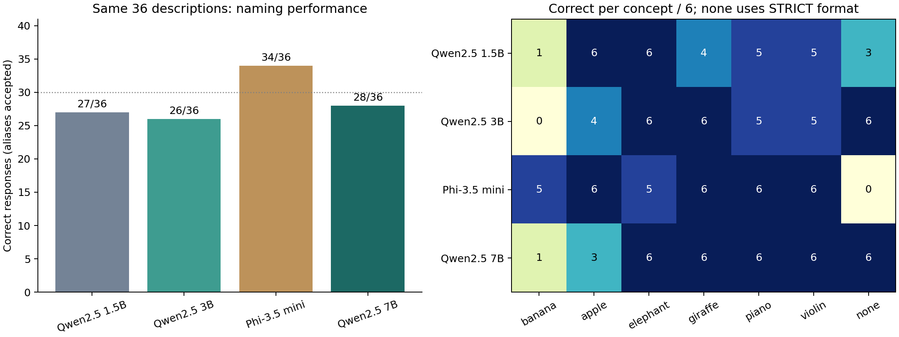

# 同じ42問題による4モデル比較（2026年11月4日）

説明文の命名ではPhi-3.5 miniが34/36件正答し、次の確認候補になった。ただし事前固定した厳密な採用基準では全モデル不通過。本実験への採用はまだ保留する。

[実行前計画](PLAN.md) / [モデル一覧](models.json) / [Colab](four_model_comparison.ipynb) / [原回答・token・実行環境](results/) / [比較表CSV](results/comparison_summary.csv)

## 実測結果

| モデル | 説明文の正答 /36 | バナナ /6 | 最低の概念 /6 | none対照：厳密 /6 | none対照：内容確認 /6 | 事前基準 |
|---|---:|---:|---:|---:|---:|---|
| Qwen2.5 1.5B | 27（75.0%） | 1 | 1 | 3 | 3 | 不通過 |
| Qwen2.5 3B | 26（72.2%） | 0 | 0 | 6 | 6 | 不通過 |
| Phi-3.5 mini | 34（94.4%） | 5 | 5 | 0 | 6 | 不通過 |
| Qwen2.5 7B | 28（77.8%） | 1 | 1 | 6 | 6 | 不通過 |



図のnone列は事前固定した厳密採点。内容確認の列は事後診断であり、事前採点を置き換えない。

| 概念 | Qwen 1.5B | Qwen 3B | Phi mini | Qwen 7B |
|---|---:|---:|---:|---:|
| バナナ | 1/6 | 0/6 | 5/6 | 1/6 |
| リンゴ | 6/6 | 4/6 | 6/6 | 3/6 |
| ゾウ | 6/6 | 6/6 | 5/6 | 6/6 |
| キリン | 4/6 | 6/6 | 6/6 | 6/6 |
| ピアノ | 5/6 | 5/6 | 6/6 | 6/6 |
| バイオリン | 5/6 | 5/6 | 6/6 | 6/6 |

## 採点上の発見：Phiの0/6は意味の誤りではない

none対照は、請求書・電車・会計士・大工・荷物・プリンターについての文章で、特定の果物・動物・楽器を説明していない。Phiは全6件で「None.」の後に理由を付けた。全原回答を人手確認すると、いずれも該当なしという内容だった。例えば `None. The context does not describe a specific fruit.`。

事前ルールは回答全体が許容されたnone表現に一致することを要求し、説明付きの回答を除外していた。「名前だけ」という指示への形式違反はあるが、「該当しない文章から無理に概念を答えた」と解釈するのは誤りである。内容と形式を別に報告する必要がある。

[none対照全24回答と事後診断](results/none_format_diagnostic.csv)を保存。事後診断は先頭のNone＋句読点／文末を検出し、原回答も確認した。事前基準のall_passは全モデルfalseのまま保持しており、事後ルールで「事前基準に合格」とは主張しない。

Phiの命名誤答は2件：バナナの説明にMango、長い鼻を持つゾウの説明にGiraffe。Qwen 3Bではバナナ6件すべてにNone、7Bでもバナナ5件が誤答だった。サイズを増やせばこの課題が単調に改善するとはいえない。

## 条件・検算・限界

対象は6概念×6説明36件とnone対照6件。user prompt・元の採点規則は全モデル共通。systemは `You are a helpful assistant.`、FP16/SDPA、量子化なし、greedy、最大32token、repetition_penalty=1.0、各モデル固有のchat templateを使用した。旧1.5Bの25/36とはsystem・反復ペナルティ等が異なるため、今回の比較値には同条件で再実行した27/36を用いる。

全4モデル42件ずつ、計168回答が完了。切り詰め0件。verify.pyでモデルrevision、実行前計画・コードのハッシュ、42問題の一致、原回答からの再採点、token長、集計、判定を検算した。結果はユーザーがColabで実行して書き出したファイルから取り込んだ。

Tesla T4 / torch 2.11.0+cu130 / transformers 4.57.6。7Bのみ最終層・出力部等がCPUへoffloadされたため、生成時間をそのままモデル固有の速度として比較しない。モデルrevision・device_map・VRAMは各manifestに保存。

この42問は繰り返し使った校正用集合。一般的なモデル性能のランキングや未知問題への性能を保証しない。概念ごと6例しかなく、モデル間差の統計的有意性も主張しない。この実験は命名課題の確認であり、抑制効果・意味的距離・内部Probeの妥当性はまだ検証していない。

## 次に行うこと

1. Phi-3.5 miniを確認候補にする。本実験採用は保留。
2. 正答内容と「一語だけ」の形式を分ける採点規則・採用基準を、新しい回答を見る前に固定する。noneに説明が付く場合の扱い、矛盾した回答の扱いも定め、既存42問を最終評価に再利用しない。
3. 新規説明文と、元の8概念のうち残り2概念でも確認する。既知の誤答だけを避けた問題を作らず、説明の一意性を回答を見る前に人手点検する。
4. 基本課題が安定したらPhiの内部表現でProbeを学習し直し、未使用例・ラベルシャッフル・指示文への依存を検証する。その後、距離×Base/Think X/Avoid X/Think Yの本実験へ進む。

## 再現

```sh
python 1104_model_comparison/verify.py 1104_model_comparison/results
python 1104_model_comparison/analyze.py 1104_model_comparison/results
```

モデル参照：[Qwen 1.5B](https://huggingface.co/Qwen/Qwen2.5-1.5B-Instruct)、[3B](https://huggingface.co/Qwen/Qwen2.5-3B-Instruct)、[7B](https://huggingface.co/Qwen/Qwen2.5-7B-Instruct)、[Phi mini](https://huggingface.co/microsoft/Phi-3.5-mini-instruct)。
