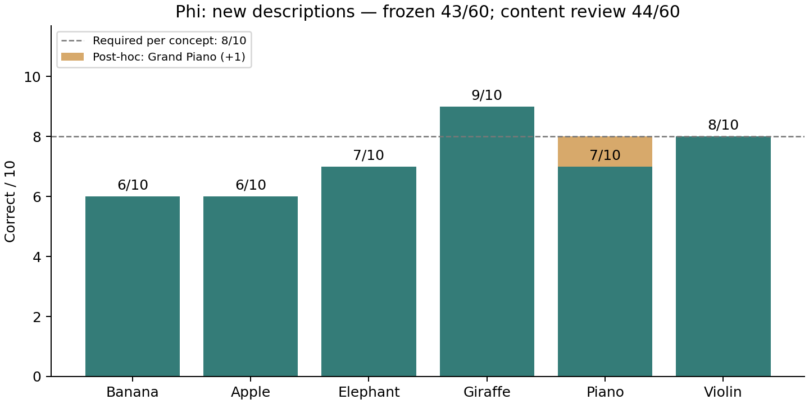

# Phi 新規説明文の確認結果

**結論：固定基準に不通過。本実験への採用は保留。** 内容・形式を分けても説明文の命名が十分安定しなかった。前の34/36件は、この新規60件へ同程度には再現しなかった。異なる問題集合の単純比較なので、性能が時間とともに低下したとはいわない。

| 指標 | 事前基準 | 実測 | 判定 |
|---|---:|---:|---|
| 説明文の固定採点 | 54/60以上 | 43/60（71.7%） | 不通過 |
| 各概念 | 全概念8/10以上 | 最低6/10、4概念で未達 | 不通過 |
| none対照の内容 | 10/12以上 | 12/12 | 通過 |
| 切り詰め | 0件 | 1件 | 次段階条件未達 |
| 形式遵守（参考） | ゲート対象外 | 説明文43/60、none 0/12 | 別指標 |

| 概念 | 固定採点 | 原回答の事後内容確認 |
|---|---:|---:|
| バナナ | 6/10 | 6/10 |
| リンゴ | 6/10 | 6/10 |
| ゾウ | 7/10 | 7/10 |
| キリン | 9/10 | 9/10 |
| ピアノ | 7/10 | 8/10 |
| バイオリン | 8/10 | 8/10 |
| 合計 | 43/60 | 44/60（73.3%） |

## 原回答の点検

全72回答を点検し、固定採点との不一致を1件確認した。piano_07の回答 `Grand Piano` はピアノの下位分類なので内容上は正解だが、事前の許容同義語リストにないため固定採点では不正解。固定スコアや合格基準は変更せず、事後の内容確認44/60を別に報告する。この1件を正解にしても54/60には届かず、最低概念6/10も変わらない。採点漏れだけでは今回の不通過を説明できない。

残る16件は意図した対象を答えていない。例：薄い緑の皮・白い果肉・芯を説明したリンゴにWatermelon、広い耳・長い鼻を説明したゾウにGiraffe、ハンマーが弦を打つ鍵盤楽器にHarpsichord。バナナにMango、バイオリンにGuitarという回答もあった。明示的なNone回答が説明文で5件あり、回答拒否寄りの傾向と別概念の誤同定が混在する。

none対照12件はすべてNoneに説明を添えており、固定した内容ルールでは正解、回答全体を一語に限定する形式では違反。今回は前回発見した形式採点の問題と、説明文自体を誤同定する問題を区別できた。

giraffe_09は32tokenで切り詰め。ただし先頭からNoneと答えており、続きが欠けたことだけが誤答の原因とはいえない。最大長を変更して再採点することはしていない。

[全回答の点検記録](raw_answer_review.csv) / [固定採点の不正解17件](frozen_errors.csv) / [概念別CSV](concept_summary.csv) / [集計JSON](summary.json)。内容確認は意図した正解との照合であり、独立評定者が文章の一意性を保証したものではない。曲がった熱帯果実・楽器の大きさ等、一部の文は他候補との曖昧さがありうるため、この不通過からPhiの一般性能だけを原因と断定しない。

## 検証と実行条件

ユーザーがColabで実行して送付したZIPを取り込んだ。72件すべて完了。固定ファイルのハッシュ、モデルrevision、元問題、token長、原回答の再採点・集計をcheck.pyで照合して一致。一次のall_pass=falseを保持。

Phi-3.5-mini-instruct revision 2fe192450127e6a83f7441aef6e3ca586c338b77、Tesla T4、FP16/SDPA、量子化なし、全モデルGPU配置、greedy/max32token/repetition_penalty1.0。torch2.11.0+cu130、transformers4.57.6。モデル・質問・規則は実行前にGitHubへ固定しており、旧42問を混ぜていない。同概念の特徴・言い換えは共有するため、完全に独立した最終評価とは扱わない。

## 次の判断

本実験を今の命名課題のまま開始しない。モデルの大型化や新規問題での再テストを繰り返す前に、問題の明確さと質問形式を切り分ける小規模な診断を行う。

まず説明文をモデルの回答を見せずに人が点検し、一意に命名できるか・代替候補があるかを確認する。その後、同じ文について現在の「特定できなければnone」という質問と、説明に最も合う名前を答える質問を対で比較し、無関連対照も残す。この診断は探索と明記し、良く見える形式に変えて今回の事前検証が通ったとは扱わない。判断が固まった後に新しい固定評価へ進む。Probe再学習・距離×指示条件への転移はその後。
