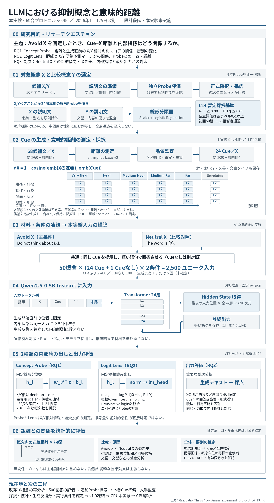

# 本実験・統合プロトコル v0.95：抑制指示下のCue意味的距離とLLM内部表現

> **2026-11-24／現行設計の正本・本実験未実施・v1.0未凍結。** 研究方針と実装要件を統合した準備版。旧[v0.9](main_experiment_protocol_v0_9.md)、[旧プロトコル](main_experiment_protocol.md)、[設計検討記録](main_experiment_design_v0_5.md)および個別判断資料は歴史的記録として保存する。旧資料に矛盾する優先順位・条件・規模・打ち切り判断がある場合は本書を優先する。

> **改訂（2026-11-25）：ラボミーティングの指導内容・追加分析・選定条件の検討事項を冒頭に追記。未実施・未凍結。**

> **改訂（2026-11-24）：全24層Probe方針を追加。** 最後の入力トークンに固定し、各層専用のProbeを学習・独立評価する。概念採択は従来のL24基準を維持し、中間層の性能は層別の解釈可否に用いる。全層通過は要求しない。追加検証・実装は未実施。

[リポジトリTOP](../README.md) · [研究概要](research_overview.md) · [パイロット解釈](../experiments/2026-11/1112_qwen_suppression_pilot/results/20261112_qwen_suppression_pilot_v1/INTERPRETATION_20261113.md) · [Neutral X結果](../experiments/2026-11/1112_qwen_suppression_pilot/results/20261124_qwen_neutral_x_addon_v1/analysis_summary.md)

実験全体のフロー図（クリックして展開）

## 最初に確認：現在地と今後の作業

| 項目 | 状態・方針 |
|---|---|
| 研究目的・2指示条件・内部主指標 | 方針確定（下記） |
| 全24層Probeへの拡張 | 方針採用。追加探索では全24層の最後の入力位置を取得・保存し、層専用Probeを学習・評価する。L24主解析、L1–23探索的（L22/23は既定の感度分析）。実装・実測は未完了 |
| 50組の初回候補探索 | 実施済み。10カテゴリー、50 X/Y候補 |
| Probe均衡版v5 | 50組中33組が暫定基準（L24 AUC≥0.80かつBH q≤0.05）通過。正式採択・人手監査は未了 |
| **追加のProbe識別可能概念探索** | **後日実施。合計約50の異なる対象Xについて、基準を満たす固定X/Y Probeを確保することが目標**。既存33組は候補として保持 |
| 既存4概念の距離再分析 | 完了。探索的結果 |
| 10概念Pre-main | 実装済み。探索的リハーサル。本実験用刺激とは別管理 |
| **本番用Cue準備** | **後日実施・未凍結**。初回候補50 Xを準備対象とし、追加探索で新規Xが生じたらその分も追加。最終採用X/Yと対応するCueを固定 |
| 統計推定法・生成反復数・品質監査 | 最終決定待ち |
| 本実験v1.0 | 未凍結・未実施 |

**次回着手する順序（11/25更新）：** 既存10概念の出力評価・両条件の再分析・距離帯点検 → 文章生成モデル比較・選定条件の検討 → 追加Probe探索と独立評価 → 採用X/Y整理・本番Cue準備と監査 → 統計・出力評価・実行条件の確定とv1.0凍結 → GPU本実験 → CPU分析。詳細は直後の11/25フィードバック節を参照。

**50の意味：** 候補を50組調べることではなく、約50の異なる対象Xについて使用可能なProbeを確保することを目標とする。現在の33組は暫定通過数で、残りは単純計算で約17組だが、追加候補数や最終採択数は未定。基準を緩めて数を達成しない。Logit Lens・出力の対象は最終的に採択する実験概念集合とし、Probe不採択Xを含める場合はその理由・分析対象数を事前に固定する。

## 2026-11-25 ラボミーティングのフィードバックと対応計画（未実施・v1.0凍結前）

指導教員から研究の厳密性と面白さについて肯定的な評価を得た（本人報告）。研究テーマは維持し、選定条件・測定・分析を多角的に検証する。今回の発表資料を卒論発表の土台とする。以下は指摘および対応案であり、追加分析完了や採択規則の確定を意味しない。

### 優先作業
- [ ] **既存500回答の評価**：原回答を保存したまま、X/Yの明示的言及、厳密な概念同定、Cueへの回答の妥当性、形式遵守を区別して採点する。自由連想課題なので唯一の正解を仮定せず、許容回答・曖昧・判定不能の規則を事前に定め、人手確認とAI採点の一致・限界を記録する。Cueなしは別扱い。Avoid/Neutral別、距離帯別に集計し、Probe・Logit Lensと同一入力IDで対応付ける。出力評価は本実験の重要な副次分析とし、内部主解析は維持する。生成反復数も出力評価の精度と資源を踏まえて決める。
- [ ] **Neutral Xを含む既存10概念の再分析**：単相関、偏順位相関、層別相関、散布図を両条件で同じ方法・同じCue集合により表示する。条件間の符号一致だけでなく、同一CueのAvoid−Neutral差と距離の関係、効果量・不確実性も検討する。符号一致は同等性を意味しない。
- [ ] **5距離帯の実測分布の確認**：各概念の候補・採択Cueを帯別に色分けし、境界、中央値、範囲、帯間隔、文章タイプ、dY分布を確認する。五分位は件数を均等化するだけで、等間隔や5つの明瞭な集団を保証しない。目標距離＋許容幅による選定、帯間の最小間隔、候補追加、dYの狭い範囲でのマッチングを比較検討する。実現可能性と自然さを確認し、採択規則・不足時の扱いを結果を見る前に固定する。
- [ ] **Y距離調整前後の可視化**：単相関の散布図に加え、dXと内部指標を順位化し、それぞれをdYの順位に回帰した残差同士の散布図を両条件で作成する。全10概念の調整前後の係数と負相関数を簡潔な表にする。共線性・不確実性を点検し、因果的除去とは解釈しない。
- [ ] **出力と内部表現の対応分析**：同じ入力の回答分類と生成直前のProbe/Lensを比較し、概念・条件・距離を考慮する。内部スコアの高低を正誤や思考量と同一視しない。反復回答を独立した内部観測として数えない。
- [ ] **文章生成モデルの比較**：現行GPT-4o miniと教員提案の6-nano等の候補を少数概念・同じ生成要件で比較する。正式APIモデルID・利用可否・価格は別途確認。説明文の事実性・タイプ遵守・重複・名称露出、独立Probe評価、Cueの距離分布・採択率、実測トークン費用と採択1文当たり費用を比較する。性能や価格の優劣は未確認。分析対象Qwenはこの比較の対象ではない。変更時は生成モデル・設定・材料のversionを記録し、既存実験を上書きしない。
- [ ] **本実験設計の確定**：上記の探索を踏まえ、追加Probe探索（約50の異なるX・全24層）、Cue生成・選定、出力評価、統計推定・除外・CI・多重比較を具体化し、v1.0凍結後に本実験を実施する。望ましい相関方向を得るために選定条件を変更しない。

### 発表資料への反映（11/25発表時のPDFページ番号）
| ページ | 指摘・対応 |
|---|---|
| p.3 | Avoid/Neutralの共通部分と異なる冒頭文をハイライトする。 |
| p.9・12 | 5距離帯の実測分布・境界を見えるようにする。p.12の自転車・アリの散布図はNeutralを別色で重ねる。 |
| p.13 | 全概念の相関を両条件で比較できる表示を検討する。 |
| p.14 | 条件間比較と右側の層別Logit Lens図を別ページに分離し、層別図にもNeutralを表示する。 |
| p.16 | Y距離調整後の散布図を追加する（順位残差による可視化）。 |
| p.17 | Neutralの調整前後も確認・表示し、負相関数は大きな棒グラフではなく簡潔な表にする。 |

既存10概念データの再分析を先に進め、生成モデル比較と選定設計の改善を経て本実験に移る。11/25時点で追加作業は未実施。スライド改訂と実験計画の凍結は区別する。

## 0. 設計の要約

**主要な関心は指示条件間の差ではなく、Avoid X指示を固定したときのCue–X意味的距離と内部指標の関係。** Neutral Xは非抑制の比較対照に限る。出力の分析は内部指標の解釈のための重要な副次分析（11/25指導を受け拡充予定）。

| 項目 | 本実験案 |
|---|---|
| モデル | Qwen2.5-0.5B-Instruct（固定revision） |
| 対象概念X | **使用可能なProbeを持つ異なるXを約50**。初回50候補中33組暫定通過。追加探索・最終X/Y集合は未凍結 |
| Cue | 1概念につき関連5距離帯×各4文＋無関係4文＝24文 |
| 指示 | **Avoid X／Neutral X**のみ。Think X、Think Y、Baseは本実験から除外 |
| Cueなし | 概念×条件ごと1入力を別対照として追加 |
| 総入力 | 最終50概念なら50×（24+1）×2＝**2,500ユニーク入力**。実数は凍結時に再計算 |
| 内部主解析① | 第24層の凍結Concept ProbeによるX/Y相対判別スコアと距離の関係。全24層を取得・学習・評価し、L1–23を層別の補助・探索的解析に用いる |
| 内部主解析② | Logit LensによるX/Y候補文字列の対数尤度マージンと距離・層の関係 |
| 副次解析 | Neutral Xでの距離傾向、Avoidとの傾き差、無関係／Cueなし |
| 出力 | Explicit Mention Rate、Strict Semantic Mention、Cueへの回答妥当性・形式遵守と内部指標との対応（採点規則未確定） |
| 本分析の距離 | 関連20 Cueの連続コサイン距離。無関係は別扱い |

## 1. 研究背景・目的・研究質問

人間の思考抑制研究に見られる「考えない」という指示の逆説的現象を着想源とする。ただし、人間の意識・無意識・心理過程がLLMにもあることを前提としない。観測可能なHidden Stateと、そこから読み出す相対的情報に限定して検証する。

- **RQ1（主、Probe）**：Avoid X条件において、CueとXの意味的距離は、生成開始直前のHidden Stateから読み出したX/Y相対判別スコアとどう関係するか。
- **RQ1の層別拡張（探索的）**：最後の入力位置における距離–Probeスコア関係がモデル深さによってどう異なるか。各層の測定器性能も併記し、Logit Lensとの対応を検討する。主層はL24のままとする。
- **RQ2（主、Logit Lens）**：同じ距離関係は各層のX/Y固定候補語彙予測マージンにどう現れ、Probeの傾向とどの程度一致・乖離するか。
- **RQ3（副次）**：Neutral Xでも距離に伴う内部指標の変化が見られるか。その傾きはAvoid Xと違うか。また内部指標と最終出力へのX言及はどう対応するか。

距離とCue内容は共変し、距離の純粋な因果効果を識別した実験とは断定しない。期待した傾向がなくても、そのまま報告する。

## 2. モデル・実行環境・固定情報

| 種類 | 予定する設定 |
|---|---|
| 対象LLM | `Qwen/Qwen2.5-0.5B-Instruct`、revision `7ae557604adf67be50417f59c2c2f167def9a775` |
| 距離の埋め込み | `sentence-transformers/all-mpnet-base-v2`、revision `e8c3b32edf5434bc2275fc9bab85f82640a19130` |
| 推論・Hidden State | Hugging Face Transformers、PyTorch、Google Colab GPU（実際のGPUはログ） |
| Probe | StandardScaler＋LogisticRegression（学習器・C値・層・seedは独立学習時に凍結） |
| 生成設定候補 | temperature=0.7、top_p=0.9、max_new_tokens=128、5回ならseed=101/211/307/401/503 |
| 保存 | GitHub `ryouy/GraduationThesis`、CSV/JSON/Markdown、実験manifest、SHA-256 |
| 大規模処理 | 中断再開可能なチャンク実行とGitHubへのチェックポイント |

モデル・埋め込みのrevisionは既存パイロットとの継続性を優先する。**ライブラリ版、チャットテンプレート、GPU、モデル/トークナイザのrevision、実験コードのコミット、刺激/Probe/プロンプトのハッシュを本実験開始前に保存する。** GPU予算は未測定なので実行可能時間の確約はしない。

OpenAI APIは学習・評価用の候補説明文、X/Yの候補、Cueの草案、文章品質の一次点検に使える。APIキーはSecretsに置き、リポジトリへ含めない。APIの作成文やAPIによる評価は**独立した人間の評価ではない**。

**一次候補リスト作成済み（2026-11-24）：** [50概念X・比較Yの候補と選定理由](concept_pair_selection_v0_1.md) ／ [50件CSV](concept_pair_candidates_50_v0_1.csv)。**50組とも本実験用には未凍結**。過去の独立確認でFDR感度条件を通ったペアは6組。さらに2026-11-24の[文章タイプ均衡版v5の結果](../experiments/2026-11/1124_probe_50pairs/results/20261124_probe50_balanced_v5/analysis_summary.md)では、第24層AUC≥0.80かつBH補正q≤0.05を33/50組が通過した。人手監査・正式採択は未完了で、新条件への妥当性保証とはしない。

## 3. 概念X・比較概念Yの選定

> **2026-11-26 更新：** 対象Xは既存10カテゴリー×各10、計100概念を目標とする。Yは同一カテゴリー・一般的な単語・同程度のトークン数を条件とし、複数候補から事前設定した意味的距離を優先して選定する。詳細と未確定事項は[概念X・Yの選定方針](concept_selection_policy_20261126.md)を参照。本節の旧50概念計画は当時の記録として保持し、この更新を優先する。数値・正式採択条件は未凍結。

- **目標：Probe採択可能な異なるXを約50概念**。初回候補は乗り物、陸上哺乳類、海洋動物、昆虫、楽器、果物、家具、道具、植物、自然現象の10カテゴリー×5。追加探索ではカテゴリー偏りを点検し、新しいXまたは既存不通過Xに対する妥当なY候補を追加する。最終構成は未確定。
- 各Xに比較概念Yを1つ事前固定する。X/Yの区別可能性だけでなく、カテゴリー、語の多義性、名称の長さ・トークン化、CueからYへの関連性を記録する。
- **選定に内部のAvoid/Neutral本実験結果を使わない**。候補、失敗・除外、Y変更と理由を残す。Probeの性能不足を理由にYを再選定する場合は、本実験の条件別スコアを見る前に限る。
- 約50は採択目標であり、Probeの採択基準を曲げて到達させない。同じXに複数Yが通過してもXの数は1とする。Probe不採択組をLogit Lensや出力に残す場合は、本実験前に分析集合を固定して区別する。

### 3.1 Probe学習データと独立評価

1. XとYの説明文を学習用と独立評価用に別々に作る。**X/Yの名称や明白な別名を原則除く**。単なる語の伏せ字で不自然にならないよう文意を点検する。
2. 内容・情報源・構文の近い重複が、学習と評価の間にまたがらないようにする。**独立評価は単に別seedで同じ文章を生成するだけでは不十分**。生成プロンプトを変え、事実・機能・文脈の重複も監査する。
3. 凍結したモデルの最後の入力位置について、全24層のHidden Stateを保存し、X/Yペア×層ごとに独立したStandardScaler＋線形分類器を学習する。同じ学習・評価分割を全層に使用し、未知の説明文で層別ROC-AUC、正例負例ごとの分布、置換ラベル対照等を記録する。
4. **概念採択の暫定基準（L24のみ）**：独立評価AUC≥0.80、評価文は各ラベル8以上、学習ラベル置換検定のBH補正q≤0.05。従来のv5の採択目安を維持する。**採択の厳密な規則、学習文数、評価分割、shuffle回数、FDR対象範囲は追加探索前に決め、v1.0で固定する**。これは現時点で「全50組が通過した」という意味ではない。
5. 採択できなかったペアはProbe主解析から除く。その数と理由を報告し、Xの他の測定は残す。高AUCは説明文のX/Y判別精度であり、「思考量」や抑制下の概念活性の妥当性を意味しない。

### 3.2 概念採択と層別Probeの使用可否を分離する（全24層方針）

- **概念の採択は第24層のみで判定する。** 第1〜23層すべての通過、特定中間層の通過、通過層数の下限は要求しない。早期層の識別性能が低いことは概念除外の理由にしない。全層で識別しやすい概念だけを選ぶと、層方向における識別可能性の差を選抜で失う恐れがある。
- **層別の測定器評価**：全24層でAUC、評価文数、置換検定p値・補正q値、通過フラグを記録する。中間層での使用可否は概念採択とは別に判定する。暫定的にL1–23でもAUC≥0.80かつ別の探索的検定集合でBH q≤0.05を解釈可能な層の目安とする。正式な層別検定集合・判定規則は追加探索前に固定する。L24の採択用補正と混ぜて従来基準を事後変更しない。
- 低性能層もAUC・スコア・通過フラグを保存するが、距離との関連を信頼できる概念指標として解釈しない。低AUCは概念情報の不存在を意味しない。層別図では低性能層を明示し、欠測扱いの分析では分母・採用数を層ごとに報告する。層間比較は共通の通過ペア集合による感度分析も行い、概念集合の違いを層変化と混同しない。
- 既存33組はL24での暫定候補として維持する。v5の説明文・分割・固定モデルを再利用して全層特徴を再抽出し、L24の再現性を確認する。旧キャッシュがL22/23/24のみなら新たなforward passが必要。新規候補も全24層特徴を同じ方式で保存する。L24不通過組を中間層の好結果だけで主解析に昇格させない。
- 同一入力の全層Hidden Stateは1回のforward passで得られるため、層ごとの再推論は不要。ただしProbe学習・置換検定の計算量と保存量は増える。実行前にCPU処理・保存形式・予算を見積もる。

### 3.3 追加のProbe探索（後日実施・未完了）

- [v5の全50組評価](../experiments/2026-11/1124_probe_50pairs/results/20261124_probe50_balanced_v5/pair_probe_scores.csv)・[集計](../experiments/2026-11/1124_probe_50pairs/results/20261124_probe50_balanced_v5/analysis_summary.md)・[実行Colab](../experiments/2026-11/1124_probe_50pairs/qwen_probe_50pairs_balanced_validation_v5.ipynb)を出発点とする。33組通過、35組がAUC≥0.80、AUC中央値0.906。全50組の結果を保存する。
- v5では各概念8学習＋8独立評価文、構造・動作・場面・機能各2文／split、L22/23/24、StandardScaler＋LogisticRegression(C=0.1, liblinear, seed=42)、499回ラベル置換、L24 AUC≥0.80かつBH q≤0.05を暫定判定に使用。LOO・文章タイプ別性能・重複・名称露出も記録。
- 後日、新規X候補や合理的なY変更候補を追加し、原則として同じL24検証方式・閾値でスクリーニングし、全24層の評価を並行する。既存33組を無条件に確定とはしない。候補ID、カテゴリー、X/Y、変更理由、全通過・不通過結果を記録し、同一Xの重複採択を避ける。
- 追加探索前に候補数／バッチ・停止条件・Yの選定規則・多重比較の扱いを決める。各バッチのBH qを単純に統合して全候補のFDRが制御されたとみなさない。最終採択集合の独立確認・再評価規則はv1.0凍結前に決め、条件別の本実験スコアを用いた選抜を禁止する。
- 50に達しなくても評価条件を事後的に緩めない。候補不足・人手監査・資源制約があれば、その時点の採択数と理由を報告する。高AUCは抑制下の絶対的概念活性や思考量を保証しない。

### 3.4 比較概念Yへの距離に関する注意メモ（2026-11-25）

[10概念Pre-mainの追加分析](../experiments/2026-11/1125_pre_main_distance_sensitivity/README.md)から得た設計上の教訓。Probe・Logit LensはXの絶対的活性ではなくX/Y相対指標であるため、CueとXの距離だけでなくCueとYの距離も常に意識する。

- 第24層・Avoid X・関連20 Cue/概念の探索的偏順位相関では、Y距離を調整すると負相関を示す概念数がProbeで5→8/10、Logit Lensで3→7/10に増えた。Neutral Xでも調整後の符号は両指標とも全10概念でAvoid Xと一致した。例：アリのProbeは+0.302→−0.306。これはY距離との共変動が単相関に関係し得ることを示唆するが、因果効果・抑制固有性・統計的有意性を証明しない。
- Cue準備時はX距離に加えてY距離、X/Y距離間の相関、Yを直接説明していないか、無関係対照が両概念から内容上無関係かを点検する。X距離帯ごとのY距離分布も確認し、可能な範囲で偏りを抑える。Y距離の完全一致を強制して自然さやX距離の幅を損なわない。
- 分析時は従来のX距離との単相関を残し、Y距離を考慮した偏順位相関または共変量調整回帰を補助・感度分析として併記する方針を検討する。X/Y距離の共線性、各概念の刺激数、Cue内容・文長等の交絡、推定の不確実性に注意する。
- この追加分析は事後的・小規模であり、人手監査未実施、CI・検定未実施。Logit Lensは保存済み単相関から計算した。負相関を増やすために概念・Y・Cueを選び直さない。採択基準や主解析を変更する決定ではなく、具体的な刺激選定・調整方法は本実験の結果を見る前に固定する。

## 4. Cue刺激生成、関連5距離帯＋無関係

### 4.1 数と構造

概念ごとに**24 Cue**＝関連20文（Very Near／Near／Medium Near／Medium Far／Far各4文）＋意味的無関係の対照4文。さらにCueなし条件を別に用意する。

関連Cueは距離が大きくなる順に5つの相対帯へ選ぶ。**Unrelatedは単なる連続距離の最遠帯ではなく、内容上の無関係性を別途確認する独立対照**で、主距離回帰に含めない。

### 4.2 距離の算出

固定した短いXの定義文とCueを埋め込み、`d_X = 1 − cosine_similarity(emb(definition_X), emb(cue))`。併せてXの名称単体との距離、固定Y定義文との距離`d_Y`、`d_X−d_Y`、語数、token数、文章タイプ等を保存する。実測距離は連続的な主説明変数とし、5帯は刺激の配置と図示に使う。

全Xに共通の固定数値の区切りを強要しない。分布が異なるので、各Xの候補距離の範囲と5帯の境界・実測重なりを保存する。**概念間で同じ「Far」の距離が等しいとは主張しない。**

### 4.3 文面のタイプを揃える

近距離が部品や直接特徴、遠距離が単なる風景になるような交絡を抑える。関連5帯それぞれ4文の**暫定テンプレート**として、構造・特徴（structure）／動作・行為（action）／場面・状況（situation）／機能・用途・効果（function）を各1文程度とする。概念カテゴリーに不適切なら、そのカテゴリーの内部で使える文体へ**事前に**変更する。

ただし距離を無理に操作して意味的関連や自然な英文を失わない。文長・具体性・対象の直接的特徴の出現・Y関連などの偏りを記録し、必要に応じて補助分析する。

### 4.4 候補生成・品質監査・凍結

1. 各概念に24文を超える候補を作る（OpenAI API利用可）。後続のQwen出力やProbe条件差は選定に使わない。
2. 自然さ、同義語／X/Y名称露出、事実誤認、重複、文章タイプの構成、Xとの関連経路、Yへの連想、コサイン距離を自動点検する。
3. 疑義のある文を優先して点検し、無作為抽出でも自動監査漏れを確認する。AI単独監査を「人手検証済み」とは表記しない。
4. 採択した関連5×4、無関係4をCSVとして固定し、選定理由・原候補ID・距離・分類基準・version・SHA-256を保存。**実験結果を見たあとでCueを交換しない**。

**過去の64 Cueパイロットは監査・採択の参考**であり、本実験用1,200 Cueの独立評価を済ませたことにはならない。

### 4.5 本実験用Cueの独立準備・凍結（2026-11-24 方針追記）

**本実験のQwen推論とは分離し、Cueを事前に準備・監査・凍結する。** 初回候補50 XはProbe暫定採択可否にかかわらず準備対象とし、追加探索で新たなX/Yを採用する場合は対応する刺激も準備・再監査する。初回不通過17組もLogit Lens・出力の候補として残せるが、本実験の実施集合は最終採択時に固定する。現在は準備方針のみで、本番用Cueの作成は後日実施する。

- 独立したCPU Colab `experiments/2026-11/1124_cue_preparation_50concepts/cue_preparation.ipynb` を作成予定（未実装）。OpenAI APIによる候補生成、固定埋め込みモデルでの距離算出、選定・品質点検を行い、Qwenの条件別推論や出力解析は行わない。
- 暫定候補生成規模：1概念あたり関連60文（4文章タイプ×5想定距離帯×3）＋無関係8文（4タイプ×2）。50概念で3,400候補（追加探索による新規Xは別途加算）。最終50概念の場合、実測距離から関連5帯×4文＋無関係4文を採択する目標は1,200文（関連1,000・無関係200）。生成した想定距離帯と実測による帯は区別し、帯ごとの文章タイプ不足や距離の重なりを記録する。
- 各X/Yの固定定義、埋め込みモデル・revision、候補の生成プロンプト・APIモデル、候補ID、文章タイプ、X/Y距離・名称露出・重複・関連性・自然さの点検結果、採択理由・除外理由を保存する。Unrelatedの内容上の無関係性を別途確認する。
- **Cueは最初から逐次生成方式を採用する（Pre-mainの生成失敗から得た実装上の教訓）。** 概念×文章タイプ×想定距離帯を生成単位とし、関連帯は各3文、無関係は各2文を目標とする。合格した文は保持し、不足分だけ追加生成する。17文一括生成・全件再生成は行わない。名称混入、文長、既存Probe説明文・Cueとの表層重複等の検証基準は再試行時にも変更しない。
- 概念・文章タイプ・距離帯単位のチェックポイントに加え、部分的に合格した文も追記型の不変スナップショットとして保存し、中断時に復元・再検証する。生成失敗と一時的API障害は上限付き自動再試行（バックオフ付き）、認証・保存・恒久的設定エラーは停止して報告する。再試行回数・不採択理由・API呼出数を記録し、費用上限・停止条件を事前設定する。上限到達時は不足を隠さず、再開可能な状態で停止する。
- 成果物は `definitions.csv`、`cue_candidates.csv`、`cue_selected.csv`、`cue_quality.csv`、距離分布図、`manifest.json`（入力・設定・成果物のSHA-256、version、監査状況）を予定する。人手監査が未実施ならその旨を明記し、AI一次監査のみを独立人手評価としない。
- [10概念のPre-main実験](../experiments/2026-11/1124_pre_main_experiment/README.md) は探索的なリハーサルとして独立に継続する。その条件別結果・望ましい効果を見て本実験用Cueや概念を選び直さない。刺激準備は既存のPre-main実験結果とは独立した選定規則に従う。
- 本実験v1.0では、凍結済み刺激・採択Probe・固定プロンプトを読み込む専用GPUノートブックを使用し、Cueの新規生成・再選定を行わない。推論後の統計・可視化は別のCPU分析工程に分離する。

実施順：追加Probe探索・独立評価 → 対象集合の整理とCue準備・品質点検 → 刺激とプロトコルv1.0の凍結 → GPU本実験 → CPU統計解析。Cue準備のノートブック作成・実行、刺激監査および凍結は現時点で未完了。

## 5. 指示条件・入力構成

本実験の指示条件は**2つだけ**。Base／Think X／Think Y（Replace）は含めない。

| 条件 | 固定する英語指示 | 研究上の役割 |
|---|---|---|
| Avoid X | `Do not think about {X}. Read the clue and briefly name the thing it brings to mind.` | **主対象**：抑制指示を固定した距離–内部表現関係 |
| Neutral X | `The word is {X}. Read the clue and briefly name the thing it brings to mind.` | **補助対照**：抑制なしでも距離傾向が現れるか |

後続入力のCue部分は既存パイロットと同じQwen chat template、原則`Clue: {cue}\nAnswer with one short phrase.`。Cueなしは既存パイロットと同じ `No clue is provided.\nAnswer with one short phrase.` を使用する方針とし、実行コードと照合してv1.0で固定する。対象名称の提示を揃えるNeutral Xでも語順・トークン数は完全一致しないため、条件差を純粋な抑制の因果効果と解釈しない。

**注意：Avoid Xの距離–スコア関係が主解析。Avoid X−Neutral Xの平均差は主結果ではない。** 距離×条件の傾きの違いは副次解析。

## 6. 取得するデータ・測定位置・規模

以下は最終50 Xの場合の目安。実際は実験採択Xの数を N、Probe採択Xの数を M とし、入力50N、Probeスコア最大1,200M、Logit Lens候補別行2,400N、生成50N×反復数とする。Probeの層別有効行数は独立評価の通過数に依存する。両内部指標の比較は共通の採択Xで行う。

| データ | 1概念当たり | 50概念 |
|---|---:|---:|
| 関連Cue | 5帯×4=20 | 1,000 |
| 無関係Cue | 4 | 200 |
| Cueありの条件別入力 | 24×2=48 | 2,400 |
| Cueなしの条件別入力 | 1×2=2 | 100 |
| **入力合計** | **50** | **2,500** |
| Probe全24層（スコア保存） | 50×24=1,200 | 最大60,000（全ペア採択なら） |
| 最後の入力位置のHidden State（全24層） | 50×24×896要素 | 53,760,000要素（float32生配列で約215 MB／205 MiB、付帯情報・学習評価分は別） |
| Logit Lens：24層×X/Y候補2つ | 50×24×2=2,400 | 120,000 |
| 生成回答 | 50×1回または5回 | 2,500または12,500 |

**Hidden Stateの主位置**：最後の入力トークン（assistant生成開始直前）で、同一入力につき1回取得。生成用乱数seedを変えても、この入力時点のHidden Stateは原則同じであり、生成反復を独立した内部サンプルとして数えない。全24層の最後の入力位置の896次元Hidden Stateを保存し、Probe採択済みペアの各層専用Probeスコアと層1–24のLogit Lens用値を取得する。途中の入力位置・自由生成中のHidden Stateは対象外。複数トークン候補のLogit Lensでは候補接頭辞の追加によるteacher forcingを別途行う。

生成回数（1か5か）は本実験前にGPU見積もりと出力解析の必要性を踏まえ固定する。出力なしではRQ3の出力対応を扱えないが、内部解析は生成回数とは独立して実施できる。

## 7. 主指標① 固定Concept Probe

1. 説明文X/Yで事前に学習・検証・凍結したLinear Probe（scalerと係数と符号）を、同じQwenの上記Hidden State位置に適用する。
2. 主要層は**第24層**。第22・23層は既定の感度分析、第1〜21層は追加の探索的層別分析。全24層について層専用Probeを学習・独立評価し、他層の係数を流用しない。低性能層のスコアは保存するが、概念指標としての解釈は制限する（3.2節）。
3. **主アウトカム**はAvoid XにおけるX方向のdecision scoreと、関連20 Cueの**連続距離との関係**。概念ごとの傾き・分布を求める。
4. Yの選び方がX/Yスコアに影響する。異なるX/Yの生のdecision scoreを一括平均しない。スケーリングを用いる場合は独立した学習／評価データから決めてv1.0で凍結する。
5. Neutral Xによる距離–Probe傾向は副次対照。その他の指示比較を探索的に足さない。
6. Probeの高AUCは既知の説明文形式での識別可能性であり、対象概念への注意量・心理状態・抑制成功の直接指標ではない。

## 8. 主指標② Logit Lens

1. 固定Qwenの各層Hidden Stateに必要な最終正規化・lm_headを適用し、固定したX/Y表記への語彙予測を測る。
2. **`margin_l = logP_l(X) − logP_l(Y)`** を計算する。対象が複数トークンならteacher forcingによる**候補文字列系列の条件付き対数尤度**を用い、単一位置・単一トークンLogit Lensと同じ測定だとはみなさない。トークン境界、先頭スペース、候補の長さを固定・保存する。
3. 第24層のmarginと連続距離の関係を主要な単一層の要約とする。全24層の軌跡（距離帯別の曲線）は層別・探索的な主題として示す。**層が進むことと、生成時間が進むことは違う**。
4. 最終層でnative forward logitsとの一致を確認し、実装の数値許容誤差をv1.0で固定。Qwenのnormalization／tokenizerを検証する。
5. Probeとは異なる読み出し機構であり、結果方向が一致しなくてもそのまま示す。Y候補の選び方、語数、トークン数の違いを考察する。

## 9. 統計解析・図示（事前にv1.0で具体化）

- **解析単位**：最終50概念なら関連1,000 Cueは50概念Xにネストしている。Xごとに関連20 Cueがあり、Cueは個別の刺激だが概念を跨ぐ独立性を仮定しない。
- **主説明変数**：各Xの`d_X`連続値（関連20 Cueのみ）。Xごとの距離分布が違うためX内中心化を基本候補にする。**UnrelatedとCueなしは距離回帰に入れず別比較**。
- **最初の要約**：各XでProbe第24層とLogit Lens第24層の距離回帰傾き・散布図を出し、概念ごとの効果量の分布とカテゴリー別の傾向を報告する。概念間でスコアの単位が異なるためProbeは事前決定した標準化を行うかペア内傾きのみ示す。
- **全体推定**：Xを階層単位とする回帰／ランダム傾きモデル、または概念単位で再標本化するブートストラップ等を候補とする。**推定器・共変量・信頼区間・多重比較の扱いは実際の本実験を見る前にv1.0で一つに確定する**。50概念は便宜選抜であり、厳密な母集団無作為標本ではない。
- **Neutral Xの補助解析**：同じX・Cueに対応するNeutral Xの距離傾向を求め、距離×条件交互作用（傾き差）を副次的に示す。絶対スコアの条件差そのものを主目的にしない。
- **層別可視化**：ProbeとLogit Lensの1–24層の距離関連（概念内Spearman相関、または事前に標準化した傾き等）を図示する。Probeの層間の生decision scoreを直接比較しない。層別AUC・通過フラグ・有効概念数を併記し、必要に応じて共通通過集合で比較する。第24層は主要な単一層の要約、その他の層は補助・探索的。24層×複数指標で無補正の「有意」を大量に主張しない。層ごとの最大効果を事後的に主結果に選ばない。
- **比較概念Yへの距離（注意メモ）**：3.4節を参照。X距離の単相関を残し、Y距離を調整した補助分析を事前に設計する。
- **感度分析**：Cue文長・文章タイプ・具体性・Yへの距離等の交絡を検討。五つの相対距離帯の可視化、対象単語の露出があったCueを除く再集計の扱いは事前固定する。
- **複数主解析**：ProbeとLogit Lensの結果は別々に報告し、二つが一致することを成功条件にしない。推測統計の主張は事前指定した検定集合と補正に従う。

## 10. 出力の副次分析・内部との対応

**11/25更新：** 出力の妥当性と内部指標の対応を重要な副次分析として追加する。具体的な採点基準・独立確認・条件別集計・反復数は冒頭のフィードバック節に従いv1.0前に確定する。

- **補助指標**：固定した名称・同義語辞書に基づくExplicit Mention Rate（出力中にXの語形が出た割合）。
- **参考指標**：strict X identificationとしてのSemantic Mention Rate（LLM API評価を使用する場合）。明示的な語の出現、Xそのものを指す回答、関連するだけの回答は別概念であり混ぜない。
- 出力がXを含まないときも、内部指標の距離関係が見られるかを確認する。**「出力しないが内心で考えている」といった心理化はしない**。
- API評価には保留・誤判定がある。評価モデルとプロンプトを保存し、AI評価を人手ゴールドラベルと呼ばない。出力のAPI採点を実施できなくても主たる内部解析は実施可能。

## 11. 品質・再現性・停止条件

- **凍結するもの**：X/Y対応とその採択記録、学習・評価の説明文・全24層の特徴量・層専用Probe重み・層別評価結果と通過フラグ、全Cueと距離・帯、条件文、Qwenのrevision、取得位置、解析器、事前除外条件、評価辞書、manifest、各SHA。
- 再現可能な入力IDは`X_id × cue_id × condition`。Cueなしは明確な特別IDにする。生成seedは別列。プロンプトの二重実行・欠損・ハッシュ不一致を検出する。
- モデル実行の途中結果は小分けに保存し、既存ファイルは不変を原則に再開する。GPU・torch/transformers/scikit-learn版と数値整合性を記録する。
- 値が非有限、入力欠損、revision不一致、保存失敗などの**技術的な欠陥**だけを修正・再実行の根拠にし、望んだ効果が出ないことを理由にCueやモデルを変えない。失敗・逸脱出力も残して報告する。
- 既存パイロットの刺激、採点、学習重み、結果を事後改変しない。新規本実験は別run_idと固定versionで管理する。
- OpenAI API生成とAPI監査は独立した人手評価ではない。人手評価を行わない場合は適用範囲の限界を明記し、レビューが行われたものと混同しない。

## 12. 予備実験からの学び（歴史的資料と区別）

**既存4概念は交通手段のみ。** それぞれ近4・中4・遠4・無関係4 Cue（計64文）をAI一次監査後に凍結し、Qwenの4条件パイロット（272入力、1,360回答）でProbe/Logit Lensと出力を取得。Neutral Xを加えた追加パイロット（68入力、340回答）も完了した。

- [旧プロトコル（変更しない歴史的設計）](main_experiment_protocol.md)
- [4条件パイロット統合解釈](../experiments/2026-11/1112_qwen_suppression_pilot/results/20261112_qwen_suppression_pilot_v1/INTERPRETATION_20261113.md)
- [Neutral Xの追加結果](../experiments/2026-11/1112_qwen_suppression_pilot/results/20261124_qwen_neutral_x_addon_v1/analysis_summary.md)
- [Cue64文のAI点検と限界](cue_validation_decision_v0_1.md)
- [Probeの能力と限界の判断](probe_role_decision_v0_1.md)
- [出力評価の監査（人手未了）](output_evaluation_decision_v0_1.md)
- [独立した新説明文によるProbe確認](../experiments/2026-11/1112_qwen_probe_independent_confirmation/results/20261112_newfacts_16targets_v1/analysis_summary.md)

旧パイロットではNeutral XよりAvoid Xの明示的X言及は少なかったが、**本実験で中心とするのは条件の平均差ではなく、Avoid X内での距離–内部指標の関係**。パイロットの事後的知見を本実験の事前独立検証と同じものとして扱わない。

**50組Probe検証（2026-11-24）：** [初回独立評価と均衡版の実験記録](../experiments/2026-11/1124_probe_50pairs/README.md)。均衡版v5は実行済み、33組暫定通過。正式採択・約50組への追加探索は未完了。

**v5解釈メモ：** [文章タイプ均衡版でなぜ性能が改善したと考えられるか](../experiments/2026-11/1124_probe_50pairs/results/20261124_probe50_balanced_v5/INTERPRETATION.md) に、v1→v5の改善仮説と限界を整理した。文章タイプのミスマッチ低減が一因と考えられるが、説明文内容やAPI生成差も同時に変わっているため因果効果とは断定しない。

**追加Probe品質検証（2026-11-24）：** [文章タイプ均衡版50組Colab](https://colab.research.google.com/github/ryouy/GraduationThesis/blob/main/experiments/2026-11/1124_probe_50pairs/qwen_probe_50pairs_balanced_validation.ipynb) を作成。旧50組とモデル・学習器を揃え、構造・動作・場面・用途を学習／評価で均衡させて再評価する。**当時は未実行・採択未確定**。その後、[均衡版v5](../experiments/2026-11/1124_probe_50pairs/qwen_probe_50pairs_balanced_validation_v5.ipynb) の実行が完了し、33/50組が暫定基準を通過した（人手監査・正式採択は未完了）。前回との差は文章内容の差も含むため、文章タイプの因果的効果とは断定しない。

**距離再分析（2026-11-24）：** [4概念・距離再分析結果](../experiments/2026-11/1124_distance_representation_analysis/results/20261124_distance_reanalysis_v1/analysis_summary.md)。L24では両条件で概念内の相関符号が一致し、ProbeとLogit Lensで4概念中3概念の符号が一致。Avoid XのL22では両指標で全4概念が負の順位相関。ただし探索的な層探索で、乗り物4概念・関連12 Cueずつに限定される。これを理由に主要層を変更しない。

**Pre-main（2026-11-24）：** [10概念の縮小実験](../experiments/2026-11/1124_pre_main_experiment/README.md)。本実験の実装リハーサルであり、本番用Cueの採択・正式結果とは分離する。逐次生成・チェックポイント設計に知見を反映するが、効果方向によって本実験刺激・指標を変更しない。

## 13. 実施手順とv1.0開始前チェックリスト

- [x] 初回50 X/Y候補を作成し、均衡版v5の独立Probeスクリーニングを実施（33組暫定通過）。
- [ ] 11/25指導への対応：既存回答の評価、Neutral込み再分析、距離帯点検、Y距離調整の可視化、生成モデル比較と選定規則の検討（冒頭参照）。
- [x] Probe全24層化の設計方針を採用（最後の入力位置固定、概念採択はL24、層別妥当性は別判定）。
- [ ] **後日：追加Probe探索・全24層評価**。約50の異なるXでL24採択可能なProbeを目標に、候補追加・独立確認・多重性・停止規則を設定して検証する。既存v5候補も全層を再評価する。正式採択表、層別性能・通過フラグ、全層特徴量と層専用固定重み・学習評価データのSHAを保存。
- [ ] **後日：本番用Cue準備**。独立CPU Colabを作成し、逐次生成・中断再開・距離測定・品質点検を実施。最終50概念なら1,200 Cueを凍結する。準備対象が50を超える場合は実数を記録。
- [ ] 対象集合・比較Y・刺激・監査範囲を確定。人手監査の実施有無と限界を記録。
- [ ] 生成反復数（1または5）、トークン表記、標準化、推定器、CI、共変量、除外、多重性を決定する。
- [ ] GPU本実験専用ColabとCPU分析Colabに全24層Probe取得・層別評価フラグ・可視化・再現性チェックを実装。中断再開・数値整合性を確認し、実際のN/Mから件数を再計算する。
- [ ] 全成果物・コード・入力・解析計画のSHAを固定し、v1.0と本実験run_idを発行してから実行する。

**v0.95は現行方針を統合した設計書であって、凍結済みプロトコルや事前登録ではない。** 旧資料・実験結果は変更しない。未確定事項を後日完了した段階でv1.0にする。
