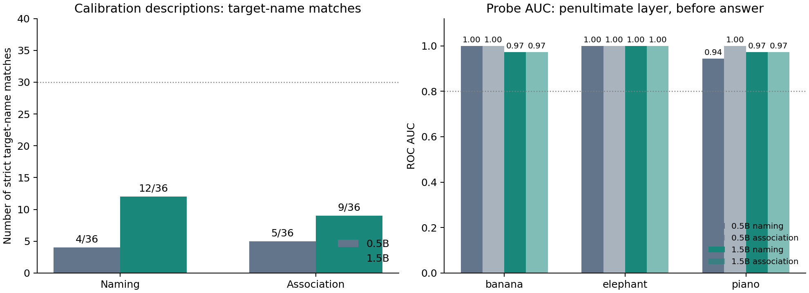

# モデル・質問・Probeの基本動作確認

0.5B/1.5B、命名/自由連想を同じ校正問題で比較する。3ペア6概念のみ。抑制指示は入れず、抑制効果を見て採用方法を選ばない。

実行前固定の [PLAN.md](PLAN.md) に評価集合・採用基準・限界を記載。[model_question_probe_check.ipynb](model_question_probe_check.ipynb) をColab T4で実行する。

- 各モデル：明確説明36件×2質問＋既存手がかり36件×2質問＝144回答。
- Probe：各ペア64学習入力、評価説明12件。文脈末尾／回答直前、相対深さ50%／75%／最終直前／最終を比較。
- 主指標は回答直前・最終直前層。モデルごとに別のProbeを学習し、ラベルシャッフル20回と比較する。
- 明確説明での暫定採用基準は30/36以上かつ各概念4/6以上。Probeは3ペアすべてAUC>=.8かつシャッフル95percentile超。

評価説明は前回評価済みの校正集合であり、新規の最終テストではない。未使用の説明・残り概念での独立確認、指示表現差と抑制下への転移は別途必要。AUCは正解率でも概念の絶対活性量でもない。シャッフル20回は独立したモデル推論20回ではない。

回答の自動採点は、正しい対象名を含み、他の5候補名を含まないことを条件とする。表記揺れや同義語を取りこぼす可能性があるため、原回答も確認する。曖昧／無関連手がかりにXを正解とは置かない。

検証：`python experiments/2026-11/1103_model_check/verify.py experiments/2026-11/1103_model_check/results`。
集計・図の再作成：`python experiments/2026-11/1103_model_check/analyze.py experiments/2026-11/1103_model_check/results`。

## 実行結果（Colab T4・FP32、両モデル完了）

合計288回答、1,152個別Probeスコア、96 AUC、240シャッフル対照を保存し、個別行からAUCと採用判定を再計算して一致を確認した。

| モデル | 質問 | 対象名一致 / 36 | 3ペアの主Probe AUC範囲 | 回答の基準 | Probeの基準 |
|---|---|---:|---:|---|---|
| 0.5B | 命名 | 4/36 | 0.944〜1.000 | 未達 | 達成 |
| 0.5B | 自由連想 | 5/36 | 1.000 | 未達 | 達成 |
| 1.5B | 命名 | 12/36 | 0.972〜1.000 | 未達 | 達成 |
| 1.5B | 自由連想 | 9/36 | 0.972〜1.000 | 未達 | 達成 |

0.5Bの自由連想で2回答が32token上限に到達し、うち1件は校正説明文だった。切り詰めも課題の不安定さとして記録した。

この表は対象名の厳しい自動一致による校正値であり、意味的な正答率そのものではない。原回答では1.5Bのviolinに対するFiddleが命名2件・自由連想1件あり、妥当な別名の取りこぼしがある。この3件を加えても命名14/36、自由連想10/36で事前基準には届かない。採点ルールを変えた値で元の事前判定は置き換えない。

一方、別の果物・動物を答える失敗も見られた。0.5Bは `a massive tusked mammal with a prehensile nose` に `Tiger`、1.5Bは `a spotted ruminant with an extremely elongated neck` に `Antelope` と回答した。その他、None、文中の別の物体や部位の回答がある。自由連想はそもそも唯一の正解を持たないため、対象名に一致しない回答すべてを誤答と解釈しない。

### 事後追加：典型的な説明による正の対照

回答性能が低かったため、各概念1問ずつ、基本的な特徴をまとめた6問を追加し、直接の質問と同内容の文脈＋命名を比較した。これらは事前の校正集合ではなく、事後に作った少数の動作確認。元の校正結果と混ぜない。

| モデル | 直接質問：対象名一致 | 文脈＋命名：対象名一致 |
|---|---:|---:|
| 0.5B | 1/6 | 1/6 |
| 1.5B | 4/6 | 5/6 |

0.5Bは両形式でviolinにFiddleと回答。別名も認めればそれぞれ2/6。1.5Bは両形式でelephant/giraffe/piano/appleに正しく対応し、文脈形式ではviolinにも対応したが、bananaでは直接質問がPeach、文脈形式がNoneだった。

**判断：** 1.5B＋命名を次の検証候補とし、本実験採用は保留する。1.5Bは基本説明の一部で改善するが、現在の校正集合では採用基準に達していない。説明文の明確さ・語彙難度・唯一の対象を指定できる程度を人手で点検し、同義語を含む採点基準を事前に固定した未使用集合で確認する。現在の集合に合わせた質問の最適化は続けない。

**Probeについて：** 今回は未学習説明文を識別でき、20回シャッフル対照も上回った。しかし回答生成とは食い違っており、「内部から識別できる情報」と「モデルが実際に答えに使う情報」は同一とは限らない。AUCだけで出力・抑制効果を説明しない。抑制指示や指示文面変更への転移は未検証。

### 保存ファイル

- `results/{0.5B,1.5B}/answers.csv`：質問、入力、全原回答、対象名一致、切り詰め有無。
- `holdout_scores.csv` / `probe_auc.csv` / `shuffled.csv`：個別スコア、全位置・層のAUC、主位置・層の対照。
- `training_design.csv` / `manifest.json`：学習文、モデルrevision、コード・計画hash、層、実行環境。
- `posthoc_sanity.csv`：追加基本問題の原回答。
- `combined_summary.csv` / `accuracy_per_concept.csv` / `primary_probe_summary.csv`：再集計表。

Colab notebookには主実験後に事後対照を再実行するセルも付属。`analyze.py` はCSV読み込み時に原回答のNone等が欠損へ変換されないよう保持する。
