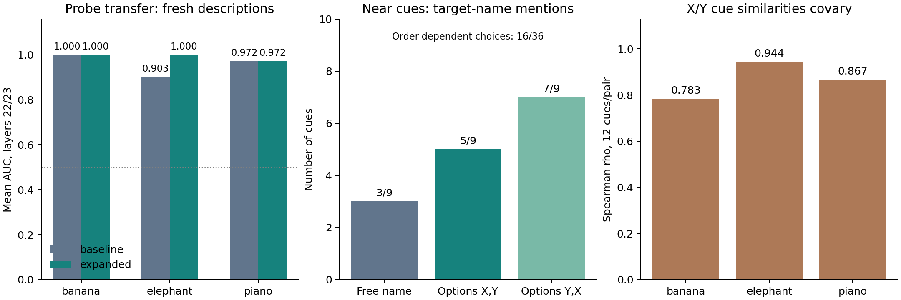

# 本実験前の追加診断：質問・Probe・比較概念

Colab T4で完了。108行動入力、未使用説明文36件（各ペア12件）、54条件別AUC。個別結果からAUC・相関を独立再計算して一致を確認した。実行前にPLAN.mdと評価文をmainへ固定、実行コードのcommitはmanifest.json参照。

## 結論

Probe学習の拡張はゾウの評価を改善したが、質問への回答が不安定で、本実験へ進む条件はまだ揃わない。質問またはモデルの再検討を優先する。抑制条件を含めていないため、抑制効果についての結論は出していない。

## 1. Probe：同じ新規評価文に対する比較

回答直前・22/23層のAUC平均。AUCは識別スコアの順位性能であり正解率ではない。

| ペア | 旧学習 | 拡張学習 |
|---|---:|---:|
| banana / apple | 1.000 | 1.000 |
| elephant / giraffe | 0.903 | 1.000 |
| piano / violin | 0.972 | 0.972 |

旧学習は名前＋3説明/クラス、拡張はそれに前回評価済み12説明/クラスを追加。各2提示形式（16→64学習入力/ペア）。新評価は6説明/クラス、名詞句3＋文3。両群で質問・位置・評価文は共通。前回と質問・評価集合が異なるため、前回AUCとの直接比較から改善要因を特定できない。バナナは旧学習でも高い。手製の少数説明文なので、全般的な概念測定の妥当性は確証できない。全層・文体別結果も保存。

## 2. 質問：近いとラベルした9手がかり

| 形式 | 対象名の言及数 / 9 |
|---|---:|
| 具体名の自由回答 | 3 / 9 |
| 二択 X→Y | 5 / 9 |
| 二択 Y→X | 7 / 9 |

各概念3手がかり。自由回答の3件はすべてpiano。例えば `The giant animal used a trunk to collect leaves.` に自由回答 `Giant Squirrel`、二択は両順序とも `Giraffe`。名前を提示しても一部の明瞭な手がかりに対応しない。全36手がかりでは、順序を反転すると分類回答（X/Y/other/ambiguous）が16/36件変化。内訳はX↔Yが13件、otherとの変化が3件。これは同じ入力のランダム反復ではなく異なる手がかりの集計。遠い・無関連手がかりではXを正解とみなさない。nearラベルも独立の人手評価を受けていない。

二択は候補名を明示するので、候補非提示の内部状態・抑制効果の測定には転用しない。

## 3. XとYへの関連性が一緒に動く

固定MiniLM、裸の概念名をアンカーにしたcos類似度。各12手がかり。

| 対象X | rho(simX, simY) | rho(simX, 出力X−Y) | rho(simX−simY, 出力X−Y) |
|---|---:|---:|---:|
| banana | 0.783 | 0.203 | −0.049 |
| elephant | 0.944 | −0.545 | −0.552 |
| piano | 0.867 | 0.406 | 0.448 |

Xに近い文ほどYにも近い傾向が強い。同じカテゴリ内の比較語なので共通特徴を拾っている可能性がある。Yとの差にしても出力との関係は概念間で一貫しない。Y距離を単に計算・差し引くだけでは統制完了と言えない。次の刺激設計ではX近/遠とY近/遠をできるだけ分離し、独立に確認する必要がある。

出力X−Yは自由回答プロンプトでの固定小文字候補全token列のlogP差。大文字・別表記を含めた全概念確率ではなく、語長・表記や回答様式にも依存する。無関連文に二択を強制する設計も本実験には適さない。

## 再実行・検証

`measurement_revision.ipynb` をColab T4で実行。`python experiments/2026-11/1103_revision/verify_results.py experiments/2026-11/1103_revision/results` で保存データの集計を再検証できる。モデル・埋め込みのrevision、コード・計画・評価文hashをmanifestへ保存した。グラフは `results/revision_summary.png`。原回答は `results/answers.csv`。
