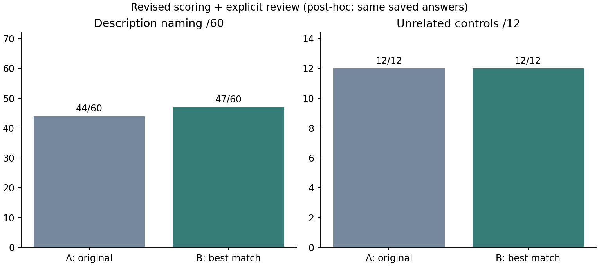

# 採点処理v2：既存384回答の再採点（2026年11月4日）

**修正・実行・検算完了。新たなモデル推論は行っていない。** 原回答と旧採点を残し、別フォルダでv2の自動判定・人による確認・回答形式を分けて記録した。

## 修正内容

- `None, as ...`、コロン・括弧・ダッシュ付きの回答を、答えと説明に分けて扱う。
- `does not describe or relate to any animal` のorを選択肢と混同しない。noneの説明には、カテゴリの不在／無関係を明示する表現を要求する。単にnotがあるだけでは正解にしない。
- Green apple／Red apple、Grand piano／Upright piano等の明示した下位分類を認める。
- 否定・訂正・留保・複数候補・未知の名前は、無理に二値採点せず `correct=None, status=review` にする。切り詰めも確認対象へ回す。
- 回答の形式と正誤を分ける。例えばバナナ問題でMangoだけと答えれば「内容不正解・形式遵守」。元のformat_correctは正解名への一致も要求していたため、v2のformat_conformsと定義が異なる。

[修正版](grade_v2.py) / [明示ルール](rules_v2.json) / [11テスト](test_grade_v2.py) / [再採点スクリプト](rescore.py)

v2は有限の語彙と字句規則による保守的なパーサーであり、任意の文章の意味を理解する自動評価器ではない。未知の下位分類は確認へ回す。既存の誤判定を見た後の修正であるため、今回の再採点を事前登録した独立検証として扱わない。

## 実測結果

| 保存済み実験 | 命名：v2＋個別確認 | none：v2 |
|---|---:|---:|
| 4モデル比較・Qwen1.5B | 27/36 | 3/6 |
| 4モデル比較・Qwen3B | 26/36 | 6/6 |
| 4モデル比較・Qwen7B | 28/36 | 6/6 |
| 4モデル比較・Phi | 34/36 | 6/6 |
| Phi新規説明文の確認 | 44/60 | 12/12 |
| Phi質問A | 44/60 | 12/12 |
| Phi質問B | 47/60 | 12/12 |



旧自動採点から判定が変わったのは15件：4モデル比較のPhi none6件、新規確認のGrand Piano1件、質問比較Bのnone7件とGreen apple1件。元の採点は上書きしていない。従来の44/60等の内容確認と一致し、Phiの本実験採用は引き続き保留。

## 確認待ちと個別判定

自動処理は4回答を確認へ回した。[adjudications.csv](adjudications.csv)に、回答を点検した今回の判定を別に保存した。判定者はこのアシスタントであり、独立した第三者の評定ではない。

- Qwen1.5BのAcoustic Grand Piano：ピアノの下位分類として正解。
- Qwen3BのAcoustic piano：ピアノとして正解。
- キリン問題でNoneと答え、途中で切れた2回答：意図した対象名を答えていないため不正解。欠けた続きは推測せず、切り詰めフラグを保持。前回の内容確認とも一致。

確認待ちを黙って不正解扱いしないため、summary.csvは自動判定の確定数・未確定数・個別確認後の正答数を別列にする。v2だけではQwen1.5Bは26正答＋1件未確定、Qwen3Bは25正答＋1件未確定であり、27/36・26/36は個別確認を含む数値である。個別確認後の内容未確定は0件。未知の回答一般まで自動処理が完成したという意味ではない。

## 保存物と検証

- [384回答の再採点](results/rescored_answers.csv)：元の判定、v2判定、理由、形式、切り詰め、過去の内容確認、個別確認を併記。
- [旧採点から変わった15件](results/changed_scores.csv)
- [確認へ回した4件](results/review_queue.csv)
- [集計](results/summary.csv) / [入力・コードSHAと検証件数](results/manifest.json)

4モデル比較168回答＋Phi新規確認72回答＋質問比較144回答＝384回答を再採点した。既存の内容確認ラベル216件のうち、自動確定214件は全件一致、未確定2件も個別確認して一致。さらに過去の内容確認表にない2回答を今回個別確認した。11テスト群で句読点、下位分類、未知語、矛盾、否定、形式、切り詰め等を確認し、verify_results.pyで全集計・216ラベルとの一致・15変更・4個別判定を検算した。

浅いcloneで元コミットがローカルにない場合は、先に `git fetch origin ee04dcc06375799bff953d5cc9ff7ad3d852bf30` を実行する。

全入力は固定コミット `ee04dcc06375799bff953d5cc9ff7ad3d852bf30` のGitオブジェクトから取得。入力6CSVとコードのSHA256を保存。再採点スクリプト自体はモデル・GPU・APIを使わず、元データを読み込むだけ。384回答には同じ文・同じ回答の再評価が含まれ、384独立刺激として統計解釈しない。

```sh
python experiments/2026-11/1104_scoring_revision/test_grade_v2.py
python experiments/2026-11/1104_scoring_revision/rescore.py
python experiments/2026-11/1104_scoring_revision/verify_results.py
python experiments/2026-11/1104_scoring_revision/plot.py
```

## 今後の利用

今後のコードはgrade_v2.gradeを利用し、correctがNoneの行を原回答の確認へ回す。新しい未知語を結果を見て許容リストへ追加する場合は、新バージョン／事後診断として残す。本実験前には使用する採点規則・個別確認の基準も固定する。

過去のgrade.py・FROZEN_SHA256.json・実行前計画・自動集計は、当時の条件を再現できるよう保持した。過去のColabを再実行すると旧一次採点が出る。最新の解釈にはこのv2結果を使い、旧スコアを事前基準に合格したことに書き換えない。
