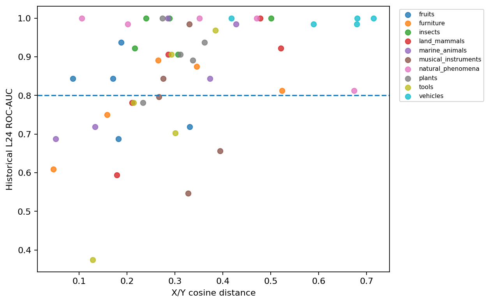
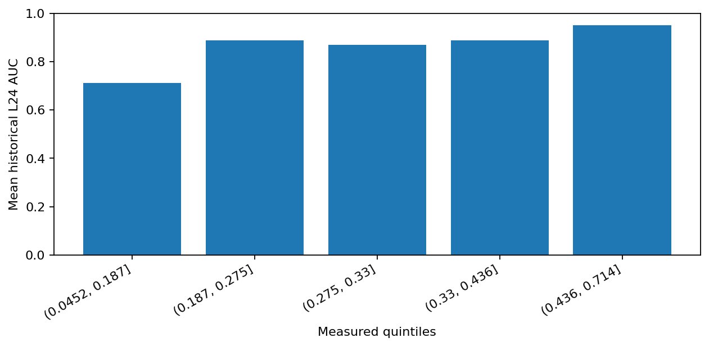
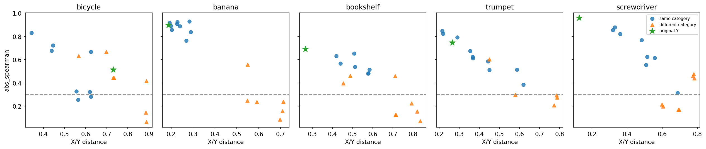
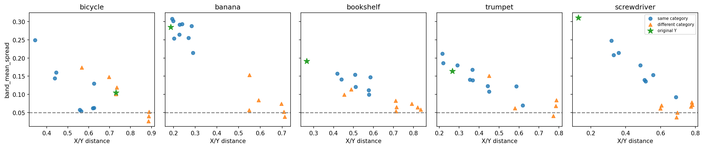
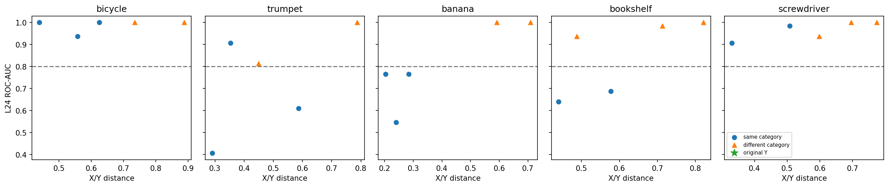
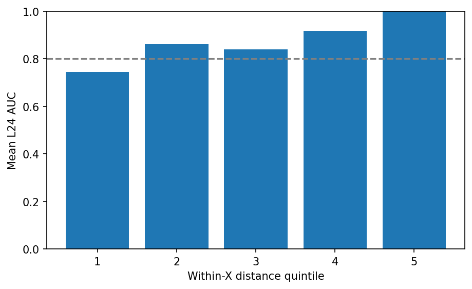
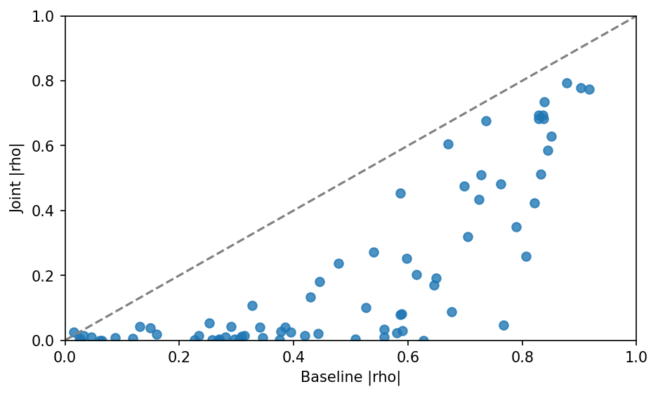
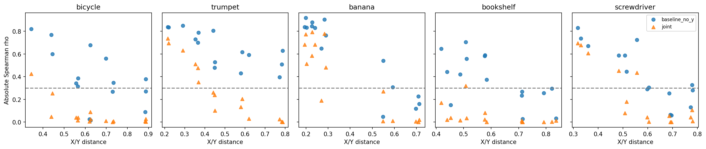
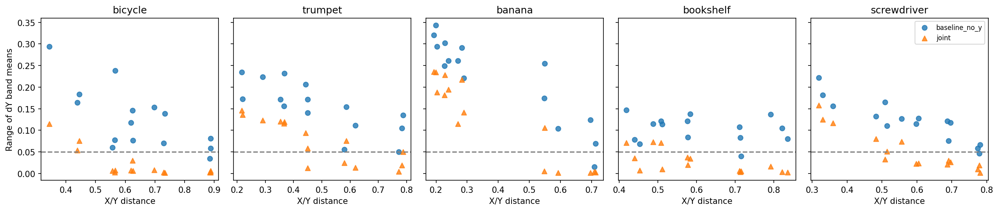
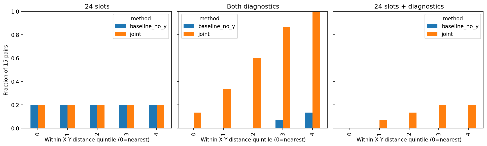

# 概念ペア（X・Y）の生成・選定方法に関する予備実験 A〜D 統合報告書

**2026年11月26日｜探索的検証・実施済み｜本実験の正式採択前**

対象研究：抑制指示下における手がかり（Cue）の意味的距離と大規模言語モデルの内部表現・出力の関係。

[実験一覧](README.md) · [Aの結果](results/20261126_concept_pair_distance_A_v1/analysis_summary.md) · [Bの結果](results/20261126_concept_pair_distance_B_v1/analysis_summary.md) · [Cの結果](results/20261126_concept_pair_distance_C_small_v1/analysis_summary.md) · [Dの結果](results/20261126_concept_pair_distance_D_v1/analysis_summary.md)

## 要旨

本研究では対象概念Xと比較概念Yの相対的な内部表現をConcept Probe等によって測定する。XとYの意味的距離が小さい場合、Probeによる識別が難しくなることに加え、CueからXへの距離とYへの距離が共変動する可能性がある。この問題に対し、概念ペア間距離とProbe識別性能、Cue距離間の交絡、およびCue選定の実現可能性を4つの予備実験で検討した。

実験Aでは既存50ペアの距離と第24層ROC-AUCに正の関連（Pearson r=0.447）を確認した。実験Bでは5種類のXを固定して75ペアを比較し、X/Y間距離が大きいほどCue距離間相関の絶対値が小さくなる傾向（X内Spearman係数の中央値−0.775）を確認した。実験Cではそのうち25ペアについて新規説明文を用いてProbeを再学習し、距離と識別性能の正の関連（同中央値+0.791）が5種類のXすべてで観察された。実験Dでは同じ候補集合・最大選定数でY距離を考慮するjoint最適化を行い、数値的統制基準の通過数が3/75から44/75に増加した。距離0.6以上の29ペアは全て数値基準を満たしたが、24文の確保も満たしたのは7/29であった。

以上から、Yを同一カテゴリーに限定せず、固定埋め込み尺度で距離0.6以上の候補を優先し、Probe性能・Cueの品質・構造・Y距離の統制を個別に確認する方針を提案する。距離0.6は探索的な優先順位の目安であり、普遍的閾値や正式採択条件を実証したものではない。抑制効果自体は本報告の検証対象外である。

## 1. 背景と目的

### 1.1 問題設定

対象概念X（抑制対象）と比較概念Yを用いる相対的な測定では、Probeの高い識別性能は必要な品質確認の一つである。ただし、独立説明文上の識別性能は、抑制指示を含む本実験入力での測定妥当性や絶対的な概念活性を保証しない。

また、CueとXとの意味的距離を説明変数として用いるとき、Yとの距離も同時に変化すれば、X/Y相対指標に対する関連の解釈が難しくなり得る。ここでいう「交絡」は刺激設計上の距離共変動を指す。因果推論上の交絡が除去されたという意味ではない。

### 1.2 検証課題

| 実験 | 検証課題 | 分析単位 |
|---|---|---|
| A | 既存ペアにおいてX/Y間距離とProbe識別性能は関連するか | 50ペア・10カテゴリー |
| B | XとCueを固定し、Yを変更しても距離共変動は変化するか | 5 X×15 Y＝75ペア |
| C | Xを固定し、新規説明文でProbeを学習しても距離と識別性能の関連は再現するか | Bから5 X×5 Y＝25ペア |
| D | 固定Cue集合から選定した後も、距離の大きいペアはY距離を統制しやすいか | Bの75ペア・同一候補集合で2選定方法 |

### 1.3 共通の距離指標

固定定義文の埋め込みを用い、コサイン距離を算出する。

- dXY = 1 − cos(e(definition_X), e(definition_Y))
- dX = 1 − cos(e(definition_X), e(Cue))
- dY = 1 − cos(e(definition_Y), e(Cue))

埋め込みモデルは sentence-transformers/all-mpnet-base-v2、revision e8c3b32edf5434bc2275fc9bab85f82640a19130。Aは統一形式の定義案を使用し、B〜Dは既存5 Xの固定定義を継承した。定義文の違いによる距離の変動に注意する。

Cue共変動の診断には、関連Cueに対する |Spearman(dX,dY)| と、5つのdX距離帯それぞれのdY平均の最大値と最小値の差（spread）を用いる。無関係Cueは独立した対照として扱い、関連Cueの主相関には含めない。Bの候補集合全体の診断とDの選定後診断は刺激集合が異なるので、同一の最適化前後比較ではない。

## 2. 実験A：既存50ペアの距離とProbe識別性能

### 2.1 方法

既存の10カテゴリー×5組、計50ペア（82種類の概念）のProbe成績を再利用した。既存Probeは8学習文・8独立評価文／ラベル、4タイプ均衡、L22〜24、L24の499回置換検定とBH補正を用いた旧仕様である。今回、新規生成APIやProbe再学習は行っていない。統一形式の定義案でdXYを測定し、L24 ROC-AUCとの関連を調べた。

### 2.2 結果

| 指標 | 結果 |
|---|---:|
| Pearson相関 | +0.4472（名目p=0.001129） |
| Spearman順位相関 | +0.4535（名目p=0.0009422） |
| カテゴリー内中心化後のPearson相関 | +0.3162 |
| 1カテゴリーずつ除外したPearson相関の範囲 | +0.358〜+0.542 |
| 旧Probe基準通過 | 33/50（66%） |

距離五分位ごとの結果（各10ペア）：

| dXYの実測範囲 | 平均AUC | 旧基準通過率 |
|---|---:|---:|
| 0.046〜0.182 | 0.711 | 30% |
| 0.188〜0.274 | 0.888 | 60% |
| 0.275〜0.330 | 0.870 | 80% |
| 0.330〜0.427 | 0.888 | 80% |
| 0.470〜0.714 | 0.952 | 80% |

### 2.3 解釈と限界

距離が大きいペアほど高い識別性能を示す傾向が観察された。カテゴリーを考慮した分析でも正の関連は残る。ただし、異なるXやYの性質、カテゴリー、共有概念などの影響を完全には分離できない。名目p値は独立性を仮定した探索的指標であり、確認的検定結果として扱わない。

定義の感度分析では、同一ペアでも定義集合を変えると最大約0.301の距離差が見られた。このため距離による候補順位付けには定義文と埋め込みrevisionの固定が必要である。旧8/8評価はv0.97の正式評価ではない。

原資料：[結果](results/20261126_concept_pair_distance_A_v1/analysis_summary.md)、[距離帯集計](results/20261126_concept_pair_distance_A_v1/distance_band_summary.csv)、[カテゴリー除外](results/20261126_concept_pair_distance_A_v1/leave_one_category_out.csv)、[定義感度](results/20261126_concept_pair_distance_A_v1/definition_sensitivity.csv)、[manifest](results/20261126_concept_pair_distance_A_v1/manifest.json)。

## 3. 実験B：固定Xにおける距離とCue共変動

### 3.1 方法

bicycle、trumpet、banana、bookshelf、screwdriverの5 Xを固定。各Xについて同一カテゴリーの近・中・弱関連候補と異カテゴリーの関連・弱関連候補を各8、計40 Y生成した。GPT-6 Luna（medium）による生成・独立AI監査の結果、200候補中198が適格と判定された。

各X内の実測dXYの五分位から中央値に近い3候補ずつ選択し、15 Y/X、計75ペアを主分析に固定した。元の比較概念Yは5アンカーとして別扱いとした。既存700 Cueのうち旧品質基準通過622文を主に使用し、X定義とdXは固定した。新規YごとのdYを測定し、関連Cue集合の相関・帯平均差を比較した。新Yに対する意味的監査は標本960件のみであり、全件ではない。生成・監査APIは95回。

### 3.2 結果

以下の係数は各Xについて15種類のYを横断した順位相関であり、個々のCueの相関そのものではない。

| X | dXYと \|ρ(dX,dY)\| の相関 | dXYとspreadの相関 |
|---|---:|---:|
| bicycle | −0.575 | −0.618 |
| trumpet | −0.968 | −0.896 |
| banana | −0.807 | −0.893 |
| bookshelf | −0.775 | −0.800 |
| screwdriver | −0.757 | −0.800 |
| **中央値** | **−0.775** | **−0.800** |

全5 Xで両指標とも負の関連。全適格198候補を使用した感度分析および同カテゴリー候補に限定した分析でも、主指標の負の関連は全5 Xで観察された。

各X内の距離五分位を集計した結果（各15ペア）：

| 五分位（近→遠） | 平均dXY | 平均 \|ρ\| | 平均spread |
|---|---:|---:|---:|
| 1 | 0.325 | 0.767 | 0.204 |
| 2 | 0.432 | 0.630 | 0.162 |
| 3 | 0.504 | 0.535 | 0.136 |
| 4 | 0.657 | 0.344 | 0.086 |
| 5 | 0.794 | 0.247 | 0.059 |

### 3.3 解釈と限界

XとCue集合が同一でもYの選び方によって共変動が変わることが示唆された。ただし、同じXとCueを共有する75ペアは独立した75観測ではない。また、遠距離帯ほど異カテゴリー候補が多い。

意味的監査を実施した小規模Cue標本に限定し、不適格を除いた感度分析では、負の関連は3/5 Xに減少した（bicycle +0.122、bookshelf +0.024）。小標本であり、主結果が全監査済みCueで再現されたとはいえない。既存Cueは元のYを意識して生成・監査されたため、新Yへの適合を保証しない。

原資料：[結果](results/20261126_concept_pair_distance_B_v1/analysis_summary.md)、[X内相関](results/20261126_concept_pair_distance_B_v1/within_x_associations.csv)、[五分位集計](results/20261126_concept_pair_distance_B_v1/distance_band_comparison.csv)、[意味監査](results/20261126_concept_pair_distance_B_v1/cue_semantic_audit.csv)、[manifest](results/20261126_concept_pair_distance_B_v1/manifest.json)。

## 4. 実験C：固定Xにおける距離とProbe識別性能

### 4.1 方法

計算時間・費用を抑えるため、Bの各X×各距離五分位から中央値に最も近い1ペアを固定し、25ペアを分析した。旧アンカーは含めない。5 Xと25 Yの計30生成ユニットに対し、16学習文・8独立探索評価文／ラベル（structure/action/situation/function各4/2文）、合計720文を新規生成した。同一X内ではX側の説明文とHidden Stateを共有した。

生成・AI監査はGPT-6 Luna（medium）。Qwen2.5-0.5B-Instruct（revision 7ae557604adf67be50417f59c2c2f167def9a775）の生成直前の最後の入力トークン、全24層のHidden Stateを取得。層別・ペア別にStandardScaler（学習データのみfit）とLogisticRegression（C=0.1、liblinear、seed42、max_iter2000）を学習し、Xを正例とした。25×24＝600 Probeを評価した。

評価集合内で文章タイプごとの正負2対2を維持するラベル置換を全1,296通り列挙した片側正確検定を実施。L24探索基準はAUC≥0.80かつp≤0.05。75ペアの正式採択ではなく、25ペアのL24を対象とした探索的BH補正も併記した。L1〜23は別検定族。API164回、入力146,287・出力195,736トークン（実測usage）。

### 4.2 結果

| X | dXYとL24 AUCのSpearman相関 |
|---|---:|
| bicycle | +0.354 |
| trumpet | +0.600 |
| banana | +0.791 |
| bookshelf | +0.900 |
| screwdriver | +0.872 |
| **中央値** | **+0.791** |

全5 Xで正の関連。探索基準通過18/25（72%）、探索的BH q≤0.05かつAUC基準通過も18/25。最遠五分位では全5ペアのAUCが1.0。

| X内五分位（近→遠） | 平均AUC | 探索基準通過 |
|---|---:|---:|
| 1 | 0.744 | 2/5 |
| 2 | 0.863 | 4/5 |
| 3 | 0.841 | 3/5 |
| 4 | 0.919 | 4/5 |
| 5 | 1.000 | 5/5 |

### 4.3 解釈と限界

Aの傾向が固定X・新規説明文でも観察された。ただし各Xにつき5点、各ラベル8評価文と小規模であり、AUC=1はその小標本での完全分離を意味する。未知入力での完全識別を意味しない。X側は全選定Yの名称・別名を禁止する一方、Y側はXと自身の名称を禁止する非対称な生成制約も影響し得る。

正式プロトコルv0.97では64学習文・32探索評価文・新規32最終独立評価文／ラベルを要求する。Cはこの手順の代替ではない。人手品質監査および本実験形式への一般化確認は未完了である。

原資料：[結果](results/20261126_concept_pair_distance_C_small_v1/analysis_summary.md)、[L24成績](results/20261126_concept_pair_distance_C_small_v1/probe_l24_scores.csv)、[全層成績](results/20261126_concept_pair_distance_C_small_v1/probe_layer_scores.csv)、[距離帯集計](results/20261126_concept_pair_distance_C_small_v1/distance_band_summary.csv)、[manifest](results/20261126_concept_pair_distance_C_small_v1/manifest.json)。

## 5. 実験D：Cue選定とY距離のjoint最適化

### 5.1 方法

Bの75主分析ペアと5アンカー、固定した700 Cueを再利用。新規API生成・埋め込み推論は行っていない。既存setting Cの5距離帯（中心から最大±0.04、隣接帯間隔0.03以上）を固定した。関連5帯×4文章タイプ、無関係4タイプの24スロットを設定し、名称・別名露出を除外、表層類似度SequenceMatcher≥0.80の近重複を同時採択しない。

主分析は旧品質通過かつ新Y名称露出なしの候補集合。追加感度分析ではBの部分監査で既知の不適格・不確実と判定された候補を除外した。未監査分は残すが、合格とはみなさない。

混合整数線形計画（MILP）によって各ペアの最大選定数を確定し、同一候補・制約・最大数で次の2方法を比較した。

- Baseline：dYを用いず、dXの帯中心からの絶対誤差を最小化。
- Joint：最大数を保持したまま5関連帯の欠損回避と両診断基準の達成を優先し、正規化した\|ρ\|とspreadの最大値および和を小さくする近似探索（3 seed×1,200ステップ）。

暫定診断基準は \|ρ(dX,dY)\|≤0.30 および spread≤0.05。両基準を満たした場合を数値統制成功、さらに24スロットを満たした場合を完全成功とする。部分集合での成功は完全成功に含めない。いずれも正式な品質承認とは区別する。

### 5.2 結果：主分析75ペア

| 指標 | Baseline | Joint |
|---|---:|---:|
| 平均選定文数 | 21.987 | 21.987 |
| 平均 \|ρ\| | 0.4839 | 0.2039 |
| 平均spread | 0.1447 | 0.0596 |
| 数値統制成功 | 3/75（4.0%） | 44/75（58.7%） |
| 24文確保 | 15/75（20.0%） | 15/75（20.0%） |
| 完全成功 | 0/75 | 9/75（12.0%） |

同じ選定数で平均\|ρ\|は約57.9%、平均spreadは約58.8%減少した。既知監査不適格を除外する感度分析でも数値統制44/75、完全成功9/75であった。

### 5.3 絶対距離別の統制・完全成功

| dXY範囲 | ペア数 | Joint平均 \|ρ\| | Joint平均spread | 数値統制 | 完全成功 |
|---|---:|---:|---:|---:|---:|
| 0〜0.3未満 | 12 | 0.628 | 0.178 | 0/12 | 0/12 |
| 0.3〜0.5未満 | 17 | 0.314 | 0.084 | 3/17 | 0/17 |
| 0.5〜0.6未満 | 17 | 0.113 | 0.034 | 12/17 | 2/17 |
| 0.6〜0.7未満 | 10 | 0.022 | 0.017 | 10/10 | 4/10 |
| 0.7〜0.8未満 | 14 | 0.016 | 0.010 | 14/14 | 3/14 |
| 0.8以上 | 5 | 0.011 | 0.003 | 5/5 | 0/5 |

dXY≥0.6の29ペアすべてで数値統制基準を達成した。ただし24文も揃ったのは7/29（24.1%）。最遠区間の完全成功0/5は、数値統制の失敗ではなく構造的な候補不足による。距離0.6未満でも15/46ペアが数値統制に成功し、2/46が完全成功したため、0.6は必要条件でもない。

### 5.4 X別の構造不足

| X | Joint数値統制 | 24文確保 | 完全成功 |
|---|---:|---:|---:|
| bicycle | 12/15 | 0/15 | 0/15 |
| trumpet | 6/15 | 0/15 | 0/15 |
| banana | 5/15 | 0/15 | 0/15 |
| bookshelf | 12/15 | 0/15 | 0/15 |
| screwdriver | 9/15 | 15/15 | 9/15 |

24文確保はscrewdriverに集中した。既存候補集合において不足している距離帯・文章タイプを追加生成する必要がある。ただし追加生成によって不足が解消されるかは本実験Dでは検証していない。

### 5.5 Cの成績との結合

Cで実際に評価した25ペアのうち、Dの完全成功かつC探索基準を満たすのは4ペア。

| X | Y | dXY | C L24 AUC |
|---|---|---:|---:|
| screwdriver | soldering iron | 0.508 | 0.984 |
| screwdriver | table | 0.598 | 0.938 |
| screwdriver | chair | 0.696 | 1.000 |
| screwdriver | grape | 0.774 | 1.000 |

Dの完全成功9ペアのうち残り5ペアはC未測定であり、不通過ではない。4/25も正式採択件数ではない。

### 5.6 限界

Jointは近似探索なので未達は数学的な統制不可能性を証明しない。構造的最大数は固定候補集合に対してのみ厳密である。主分析のjointでは平均約19.6文/ペアが新Yに対して未監査で、既知不適格の選定が1件残った。既知不適格を除く感度分析では0件となったが、未監査分は依然多い。数値的改善を意味的妥当性の保証と同一視しない。

原資料：[結果](results/20261126_concept_pair_distance_D_v1/analysis_summary.md)、[方法別集計](results/20261126_concept_pair_distance_D_v1/method_summary.csv)、[絶対距離別集計](results/20261126_concept_pair_distance_D_v1/absolute_distance_summary.csv)、[欠損スロット](results/20261126_concept_pair_distance_D_v1/missing_slots.csv)、[Cとの結合](results/20261126_concept_pair_distance_D_v1/ABC_D_joint_descriptive.csv)、[manifest](results/20261126_concept_pair_distance_D_v1/manifest.json)。

## 6. 統合考察

### 6.1 4実験の関係

| 実験 | 観察された関係 | 設計上の示唆 |
|---|---|---|
| A | dXYとAUCの正の関連（r=0.447） | 距離を候補選定変数に加える |
| B | dXYとCue共変動の負の関連（中央値−0.775） | Y変更による距離共変動の改善を検討 |
| C | 固定X・新規学習でdXYとAUCの正の関連（中央値+0.791） | 距離をProbe探索の事前順位付けに使用 |
| D | jointで数値基準通過3→44/75、遠距離29/29 | 遠いY候補とjoint選定の併用を検討 |

AとCは同じ測定対象（説明文のX/Y識別）に関する異なる設計の検証であり、BとDは同じ既存Cueに基づく候補集合診断と選定後診断である。4実験は相補的だが、統計的に独立した4回の再現実験ではない。

### 6.2 距離0.6付近の位置付け

CとDの絶対距離別結果を並べる。CとDは母数が異なり、CはDの一部である。

| dXY | Cの平均AUC | C探索基準通過 | D数値統制 | D完全成功 |
|---|---:|---:|---:|---:|
| 0〜0.3未満 | 0.621 | 0/4 | 0/12 | 0/12 |
| 0.3〜0.5未満 | 0.867 | 5/6 | 3/17 | 0/17 |
| 0.5〜0.6未満 | 0.859 | 4/6 | 12/17 | 2/17 |
| 0.6〜0.7未満 | 1.000 | 2/2 | 10/10 | 4/10 |
| 0.7〜0.8未満 | 0.997 | 5/5 | 14/14 | 3/14 |
| 0.8以上 | 1.000 | 2/2 | 5/5 | 0/5 |

dXY≥0.6ではCの9/9が探索基準を通過し、Dの29/29が数値統制に成功した。この境界は候補選定時の優先順位の実用的な目安として有望だが、データを見てから注目した探索的境界である。新規X・定義文・モデルを変えた場合の一般化は不明であり、必要十分条件ではない。

### 6.3 同一カテゴリー制約の再検討

| 指標 | 同一カテゴリー | 異カテゴリー |
|---|---:|---:|
| C：平均L24 AUC | 0.781（n=13） | 0.973（n=12） |
| C：探索基準通過 | 6/13 | 12/12 |
| D：平均dXY | 0.420（n=42） | 0.698（n=33） |
| D：Joint数値統制 | 14/42 | 30/33 |
| D：Joint完全成功 | 2/42 | 7/33 |

異カテゴリーの候補は距離が大きい傾向があり、性能差をカテゴリーそのものの効果とはみなせない。同カテゴリー内でもBの負の関連が確認されている。したがって、同カテゴリー限定を撤廃する提案は合理的だが、異カテゴリーを必須条件にする必要はない。

なお、極端に無関係なYを使う場合、X/Y相対的な読み出しが広範なカテゴリー差に支配される可能性や、Y側がほとんど活性化されないことで指標の解釈が変わる可能性もある。今回のA〜Dはこの構成概念妥当性を検証していない。距離を無制限に最大化するのではなく、Yの具体性、親しみやすさ、語彙・トークン数、両概念の意味的区別を事前に点検する。

## 7. 本実験に向けた選定方針の提案（未凍結）

以下は結果から導いた提案であり、統合プロトコルv0.97を本報告によって変更・凍結するものではない。正式な採択・不足時の打ち切り規則は次の設計文書で事前に固定する。

| 項目 | 提案 |
|---|---|
| 対象X | 10カテゴリー×10概念＝100種類を目標 |
| Y候補 | Xごとに20候補程度を目安とし、同一・異カテゴリーを含める |
| 概念の適格性 | 親しみやすく明確な概念。別名・同義語・直接的上下位概念は除外 |
| 距離 | 固定定義と固定埋め込みでdXY≥0.6を優先。絶対的な必須閾値とはしない |
| 順位付け | 距離、概念品質、トークン数等から探索前に固定。Probe AUC最大化による事後選抜は避ける |
| Probe探索 | v0.97の64学習・32探索評価文/ラベル。事前順位に沿い、最大5 Y候補を試行する現行方針 |
| Probe正式確認 | 選択・学習固定後、新規32評価文/ラベル、全確認ペアL24 AUC≥0.80・BH q≤0.05、9,999置換 |
| Cue | 5関連距離帯×4タイプ＋無関係4タイプ＝24文 |
| Cue選定 | 最大構造充足を優先し、joint最適化で\|ρ\|≤0.30・spread≤0.05を暫定目標 |
| 候補不足 | 不足帯・文章タイプを指定して追加生成し、固定境界を維持したまま再選定 |
| 品質確認 | 新Yとの関係も全件監査し、人手確認を行う。既知不適格・未確認を合格とみなさない |
| 打ち切り | 上限を事前固定し、未達でも基準を事後緩和しない。本実験効果の方向で選定しない |

推奨工程：

1. X候補・固定定義・カテゴリーを生成し監査する。
2. Y候補を生成・監査し、dXYを測定して事前順位を固定する。
3. 事前順位に従いProbeを学習・探索評価する。
4. X/Y候補に対するCue候補を生成し、dX・dYと品質を評価する。構造不足箇所に対する追加生成およびjoint選定を行う。
5. 正式確認に進むX/Yと学習済みProbeを固定し、新規独立評価・多重比較補正を行う。Cueの正式採択・固定も行う。
6. 採択数・除外理由・監査履歴・設定・ハッシュを記録し、本実験プロトコルを凍結する。

工程3〜5の具体的な候補変更順序、再試行上限、距離優先順位の扱い、数値診断未達の扱いは未確定。最終評価結果を見て同じ確認集合でYを再選択しない。

## 8. 限界と結論

- B〜Dの主要対象は5 Xのみ。ペア間でX、説明文、Cueが共有され、独立な標本数とはならない。
- dXYは定義文・埋め込みモデルに依存し、カテゴリーや語彙長・トークン数等と共変動する。
- AとCのProbe学習・評価文数は正式プロトコルより少ない。AI監査は人手確認の代替ではない。
- Dの最適化は固定候補の数値診断改善であり、新規生成による構造不足解消や全件の意味的妥当性を証明していない。
- 高いProbe AUCと低い距離共変動は測定設計上の望ましい条件だが、抑制指示下の概念表現測定の妥当性・抑制効果・因果関係を直接示さない。Logit Lensの性能も本実験群では評価していない。

以上の探索結果は、X/Yの意味的距離を候補選定に取り入れること、同一カテゴリー限定を再検討すること、そしてCueを構造制約とY距離の診断指標を同時に考慮して選定することを支持する。以後は同様の大規模探索を必須とせず、100概念に向けた事前規則の具体化、Cue候補不足の補充、正式Probe確認および品質監査を優先する。

## 9. 再現性・成果物

本報告は実測結果の再集計・統合であり、新たな推論実験やAPI呼び出しは行っていない。元データ参照時のブランチcommit：5564df7ebeba5ae7b526907c612bd44e171ab8d1。各runの入力・出力SHA-256、モデルrevision、設定、実行環境はmanifestに記録されている。

| 実験 | ノートブック | 結果 | 設定・provenance |
|---|---|---|---|
| A | [ipynb](experiment_A_distance_probe.ipynb) | [集計](results/20261126_concept_pair_distance_A_v1/analysis_summary.md) | [manifest](results/20261126_concept_pair_distance_A_v1/manifest.json) |
| B | [ipynb](experiment_B_y_distance_confound.ipynb) | [集計](results/20261126_concept_pair_distance_B_v1/analysis_summary.md) | [manifest](results/20261126_concept_pair_distance_B_v1/manifest.json) |
| C（軽量） | [ipynb](experiment_C_distance_probe.ipynb) | [集計](results/20261126_concept_pair_distance_C_small_v1/analysis_summary.md) | [manifest](results/20261126_concept_pair_distance_C_small_v1/manifest.json) |
| D | [ipynb](experiment_D_cue_joint_selection.ipynb) | [集計](results/20261126_concept_pair_distance_D_v1/analysis_summary.md) | [manifest](results/20261126_concept_pair_distance_D_v1/manifest.json) |

正式プロトコル参照：[v0.97（Probe確定節を優先）](https://github.com/ryouy/GraduationThesis/blob/8fc35efe88604f2b47577958b7feb58efde0ba94/docs/main_experiment_protocol_v0_97.md)。

本報告の提案は未承認であり、既存実験結果・プロトコル・mainを上書きしない。
